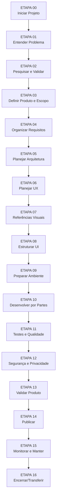

# Fluxo Completo — Visão Geral de Todas as Etapas

> Mapa completo do processo de desenvolvimento. Use para planejar e navegar.

---

## As 17 etapas em sequência



---

## Tabela resumo das etapas

| # | Etapa | Foco Principal | Entregável Chave | Pasta no Projeto |
|---|-------|----------------|------------------|------------------|
| 00 | **Iniciar Projeto** | Setup, estrutura, registro inicial | Acompanhamento.md + Registro Inicial | `00 - Início/` |
| 01 | **Entender Problema** | Descoberta, contexto, hipóteses | Definição do Problema | `01 - Descoberta/` |
| 02 | **Pesquisar e Validar** | Mercado, concorrentes, usuários, decisão | Pesquisa + Decisão de continuidade | `01 - Descoberta/` |
| 03 | **Definir Produto** | Objetivos, público, MVP, prioridades | Definição do Produto + Escopo | `02 - Produto/` |
| 04 | **Organizar Requisitos** | Funcionais, qualidade, aceitação | Requisitos Aprovados | `02 - Produto/` |
| 05 | **Planejar Arquitetura** | Tech stack, dados, APIs, decisões | Decisões de Arquitetura + Visão Técnica | `03 - Arquitetura/` |
| 06 | **Planejar UX** | Jornadas, fluxos, navegação | Fluxos do Usuário Aprovados | `04 - UX-UI/` |
| 07 | **Referências Visuais** | Inspiração, direção estética | Direção Visual + Referências | `04 - UX-UI/` |
| 08 | **Estruturar UI** | Telas, componentes, design system | Inventário de Telas + Componentes | `04 - UX-UI/` |
| 09 | **Preparar Ambiente** | Repo, tools, config, plano implementação | Ambiente OK + Plano de Implementação | `05 - Desenvolvimento/` |
| 10 | **Desenvolver por Partes** | Implementação incremental, IA | Funcionalidades validadas | `05 - Desenvolvimento/` |
| 11 | **Testes e Qualidade** | Testes automatizados + manuais | Relatório de Testes + Bugs | `06 - Testes/` |
| 12 | **Segurança e Privacidade** | Auth, dados, deps, config | Revisão de Segurança | `07 - Segurança/` |
| 13 | **Validar Produto** | Requisitos, fluxos, aceitação | Validação Final + Decisão Publicar | `08 - Publicação/` |
| 14 | **Publicar** | Deploy, verificação, rollback | Versão Publicada Verificada | `08 - Publicação/` |
| 15 | **Monitorar e Manter** | Erros, perf, deps, melhorias | Processo de Manutenção Ativo | `09 - Encerramento/` |
| 16 | **Encerrar/Transferir** | Docs final, handoff, lições | Documentação de Continuidade | `09 - Encerramento/` |

---

## Tempo estimado por etapa (referência)

| Etapa | Projeto Pequeno | Projeto Médio | Projeto Grande |
|-------|-----------------|---------------|----------------|
| 00 | 15 min | 30 min | 1 h |
| 01 | 30 min | 1-2 h | 2-4 h |
| 02 | 1-2 h | 4-8 h | 1-2 dias |
| 03 | 1 h | 2-4 h | 4-8 h |
| 04 | 1-2 h | 4-8 h | 1-2 dias |
| 05 | 1-2 h | 4-8 h | 1-2 dias |
| 06 | 1-2 h | 2-4 h | 4-8 h |
| 07 | 30 min-1 h | 2-4 h | 4-8 h |
| 08 | 1-2 h | 4-8 h | 1-2 dias |
| 09 | 30 min-1 h | 1-2 h | 2-4 h |
| 10 | Variável | Variável | Variável |
| 11 | 1-2 h | 4-8 h | 1-2 semanas |
| 12 | 1 h | 2-4 h | 1-2 dias |
| 13 | 1-2 h | 2-4 h | 4-8 h |
| 14 | 30 min-1 h | 1-2 h | 2-4 h |
| 15 | Contínuo | Contínuo | Contínuo |
| 16 | 1-2 h | 2-4 h | 4-8 h |

> [!note]
> Tempos são **referências aproximadas**. Vibe Coding acelera muito a execução (etapas 09-10), mas **não acelera decisões** (etapas 01-05, 12-13).

---

## Dependências críticas

```text
ETAPA 00 → 01 → 02 → 03 → 04 → 05 → 06 → 07 → 08 → 09 → 10 → 11 → 12 → 13 → 14 → 15 → 16
  │       │      │     │     │     │     │     │     │     │     │     │     │     │     │
  └───────┴──────┴─────┴─────┴─────┴─────┴─────┴─────┴─────┴─────┴─────┴─────┴─────┴─────┘
        Cada etapa exige a conclusão da anterior (critérios verificados)
```

### Exceções (paralelismo controlado)

| Atividades paralelas | Condição |
|---------------------|----------|
| ETAPA 06 (UX) + ETAPA 07 (Referências visuais) | Após ETAPA 05 aprovada, podem avançar juntas |
| ETAPA 10 (Desenvolver) + ETAPA 11 (Testes) | Testes de cada funcionalidade **devem** acompanhar o desenvolvimento |
| ETAPA 12 (Segurança) | Pode começar revisão preliminar na ETAPA 05, mas conclusão só após ETAPA 11 |

> [!warning]
> **Não inicie ETAPA 10 (Desenvolver) sem ETAPA 09 (Ambiente) aprovada.**
> **Não inicie ETAPA 14 (Publicar) sem ETAPA 13 (Validar) aprovada.**

---

## Ramificações condicionais (quando aplicar procedimentos extras)

| Situação | Verificar em | Ação extra |
|----------|--------------|------------|
| Login/contas de usuário | ETAPA 04 (Requisitos) | Adicionar requisitos de auth, sessão, recuperação |
| Banco de dados | ETAPA 05 (Arquitetura) | Modelagem de dados, migrações, backup |
| Pagamentos | ETAPA 04 + 12 | Requisitos PCI, revisão segurança reforçada |
| Dados pessoais (LGPD/GDPR) | ETAPA 04 + 12 | DPIA, consentimento, exclusão, DPO |
| Upload de arquivos | ETAPA 05 + 12 | Storage, validação tipo/tamanho, antivírus |
| APIs externas | ETAPA 05 + 12 | Contratos, fallback, rate limit, monitoramento |
| IA/ML no produto | ETAPA 05 + 12 | Modelo, viés, explicabilidade, fallback |
| Automações/Jobs | ETAPA 05 + 11 | Filas, retry, dead letter, observabilidade |
| E-mail/notificações | ETAPA 05 + 12 | Templates, entregabilidade, unsubscribe |
| Tempo real (WebSocket) | ETAPA 05 + 11 | Conexão, reconexão, escala, presença |
| Múltiplos perfis/permissões | ETAPA 04 + 12 | RBAC/ABAC, testes de autorização |
| Operações financeiras | ETAPA 04 + 12 | Auditoria, idempotência, conciliação |
| Usuários externos em produção | ETAPA 12 + 13 + 14 | SLA, monitoramento, incident response |

> [!important]
> Para cada situação aplicável, a etapa indicada tem seção **"Ramificações Condicionais"** com procedimentos detalhados.

---

## Portões de aprovação (obrigatórios)

| Portão | Etapa | Quem aprova | Critério |
|--------|-------|-------------|----------|
| G0 | 00 | Usuário | Estrutura criada, registro inicial preenchido |
| G1 | 01 | Usuário | Problema claro, hipóteses registradas |
| G2 | 02 | Usuário | Decisão fundamentada: continuar/reformular/abandonar |
| G3 | 03 | Usuário | Produto definido, escopo aprovado, MVP claro |
| G4 | 04 | Usuário | Requisitos claros, verificáveis, aceitação definida |
| G5 | 05 | Usuário | Arquitetura decidida, riscos técnicos conhecidos |
| G6 | 06 | Usuário | Fluxos principais validados, navegação clara |
| G7 | 07 | Usuário | Direção visual aprovada, referências documentadas |
| G8 | 08 | Usuário | Telas inventariadas, componentes definidos |
| G9 | 09 | Usuário | Ambiente funcionando, plano de impl. aprovado |
| G10 | 10 | Usuário + Validação | Cada funcionalidade: código revisado, testes passam |
| G11 | 11 | Validação | Testes planejados executados, bugs críticos corrigidos |
| G12 | 12 | Usuário + Validação | Checklist segurança OK, riscos residuais aceitos |
| G13 | 13 | Usuário | Produto corresponde ao planejado, fluxos OK |
| G14 | 14 | Usuário | Deploy verificado, smoke tests passam, rollback pronto |
| G15 | 15 | Usuário | Processo manutenção definido, métricas monitoradas |
| G16 | 16 | Usuário | Docs final completa, handoff pronto |

---

## Documentos obrigatórios por fase

### Fase Descoberta (00-02)
- [ ] Acompanhamento do Projeto
- [ ] Registro Inicial
- [ ] Definição do Problema
- [ ] Pesquisa e Validação
- [ ] Decisão de Continuidade

### Fase Produto (03-04)
- [ ] Definição do Produto
- [ ] Escopo e Limites
- [ ] Priorização de Funcionalidades
- [ ] Requisitos Funcionais
- [ ] Requisitos de Qualidade
- [ ] Critérios de Aceitação

### Fase Arquitetura (05)
- [ ] Decisões de Arquitetura (ADR)
- [ ] Visão Técnica Geral
- [ ] Modelo de Dados (se aplicável)
- [ ] Registro de Integrações

### Fase UX/UI (06-08)
- [ ] Fluxos do Usuário
- [ ] Direção Visual
- [ ] Inventário de Telas
- [ ] Registro de Componentes

### Fase Desenvolvimento (09-10)
- [ ] Plano de Implementação
- [ ] Registro de Decisões Técnicas
- [ ] Configuração de Ambientes

### Fase Qualidade (11-12)
- [ ] Plano de Testes
- [ ] Registro de Execução de Testes
- [ ] Registro de Bugs
- [ ] Revisão de Segurança

### Fase Entrega (13-14)
- [ ] Validação Final
- [ ] Checklist de Publicação
- [ ] Registro de Versão
- [ ] Plano de Rollback

### Fase Operação (15-16)
- [ ] Plano de Manutenção
- [ ] Documentação de Instalação/Execução
- [ ] Documentação de Continuidade/Encerramento
- [ ] Lições Aprendidas

---

## Navegação direta para cada etapa

### Fase 0: Início
- [[01 - Manual de Desenvolvimento/00 - Início do Projeto/ETAPA 00 - Início do Projeto]]

### Fase 1: Descoberta e Pesquisa
- [[01 - Manual de Desenvolvimento/01 - Descoberta e Pesquisa/ETAPA 01 - Entender o Problema e a Oportunidade]]
- [[01 - Manual de Desenvolvimento/01 - Descoberta e Pesquisa/ETAPA 02 - Pesquisar e Validar a Ideia]]

### Fase 2: Produto e Requisitos
- [[01 - Manual de Desenvolvimento/02 - Produto e Requisitos/ETAPA 03 - Definir o Produto e seu Escopo]]
- [[01 - Manual de Desenvolvimento/02 - Produto e Requisitos/ETAPA 04 - Organizar os Requisitos]]

### Fase 3: Arquitetura e Planejamento
- [[01 - Manual de Desenvolvimento/03 - Arquitetura e Planejamento/ETAPA 05 - Planejar a Arquitetura e a Solução Técnica]]

### Fase 4: UX e UI
- [[01 - Manual de Desenvolvimento/04 - UX e UI/ETAPA 06 - Planejar a Experiência do Usuário (UX)]]
- [[01 - Manual de Desenvolvimento/04 - UX e UI/ETAPA 07 - Pesquisar Referências e Definir a Direção Visual]]
- [[01 - Manual de Desenvolvimento/04 - UX e UI/ETAPA 08 - Estruturar a Interface (UI)]]

### Fase 5: Preparação e Desenvolvimento
- [[01 - Manual de Desenvolvimento/05 - Preparação e Desenvolvimento/ETAPA 09 - Preparar o Ambiente e o Plano de Implementação]]
- [[01 - Manual de Desenvolvimento/05 - Preparação e Desenvolvimento/ETAPA 10 - Desenvolver o Software por Partes]]

### Fase 6: Testes e Qualidade
- [[01 - Manual de Desenvolvimento/06 - Testes e Qualidade/ETAPA 11 - Executar Testes e Garantir a Qualidade]]

### Fase 7: Segurança e Validação
- [[01 - Manual de Desenvolvimento/07 - Segurança e Validação/ETAPA 12 - Revisar Segurança, Privacidade e Confiabilidade]]
- [[01 - Manual de Desenvolvimento/07 - Segurança e Validação/ETAPA 13 - Validar o Produto Completo]]

### Fase 8: Publicação e Manutenção
- [[01 - Manual de Desenvolvimento/08 - Publicação e Manutenção/ETAPA 14 - Publicar o Software]]
- [[01 - Manual de Desenvolvimento/08 - Publicação e Manutenção/ETAPA 15 - Monitorar e Manter]]
- [[01 - Manual de Desenvolvimento/08 - Publicação e Manutenção/ETAPA 16 - Encerrar ou Transferir o Projeto]]

---

## Links relacionados

- [[Início]] — Página inicial
- [[Como Usar Este Manual]] — Guia de uso
- [[Iniciar Novo Projeto]] — Começar agora
- [[01 - Manual de Desenvolvimento/Visão Geral das Etapas]] — Detalhes de cada etapa
- [[02 - Modelos/Índice de Modelos]] — Modelos para cada entregável