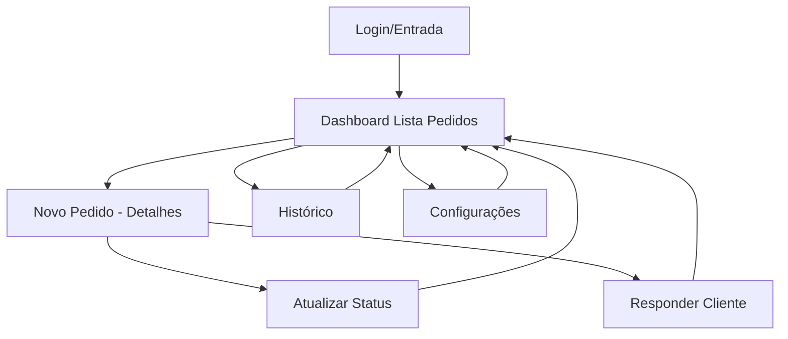

# ETAPA 06 — Planejar a Experiência do Usuário (UX)

## Objetivo

Definir **como as pessoas utilizarão o produto**: jornadas, fluxos de navegação, tarefas, decisões, pontos de fricção e prevenção/recuperação de erros — antes de pensar em aparência visual.

## Por que esta etapa existe?

UX não é "como fica bonito" — é **"como funciona para o usuário"**. Pular para UI sem UX clara gera interfaces confusas, fluxos quebrados e retrabalho visual.

## Quando começar

- ETAPA 05 concluída (Arquitetura definida, modelo de dados claro)
- Requisitos funcionais aprovados (sabe o que o sistema faz)
- Pronto para definir a experiência de uso

## O que você precisa fazer

1. **Revise os objetivos do usuário** — da ETAPA 01/03 (Jobs to be Done)
2. **Desenhe as jornadas do usuário** — do problema à solução (quando útil)
3. **Defina fluxos de navegação principais** — telas e transições (caminho feliz)
4. **Identifique caminhos alternativos** — erros, vazios, exceções, atalhos
5. **Liste decisões que o usuário precisa tomar** — em cada tela/fluxo
6. **Identifique pontos de fricção** — onde o usuário pode travar, errar, desistir
7. **Planeje prevenção de erros** — validações, confirmações, defaults inteligentes
8. **Planeje recuperação de erros** — mensagens claras, ações de correção, undo
9. **Organize a arquitetura da informação** — hierarquia, agrupamento, rotulagem
10. **Defina critérios para validar os fluxos** — como testar com usuários reais
11. **Produza o documento: Fluxos do Usuário Aprovados**

## Quem faz o quê

| Atividade | Responsável |
|-----------|-------------|
| Definir jornadas e fluxos principais | 👤 USUÁRIO (com ajuda da IA para estruturar) |
| Identificar caminhos alternativos/erro | 🤖 IA (sugere baseada em requisitos) + 👤 USUÁRIO (valida) |
| Listar decisões do usuário | 👤 USUÁRIO |
| Identificar pontos de fricção | 👤 USUÁRIO + 🤖 IA (heurísticas) |
| Planejar prevenção/recuperação de erros | 🤖 IA (sugere padrões) + 👤 USUÁRIO (aprova textos) |
| Organizar arquitetura da informação | 👤 USUÁRIO |
| Validar fluxos com usuários reais (se possível) | 👤 USUÁRIO |
| Aprovar fluxos finais | ✅ VALIDAÇÃO (você) |

## Ferramentas recomendadas

| Finalidade | Ferramentas |
|------------|-------------|
| Fluxogramas/jornadas | Mermaid.js (no Obsidian), Excalidraw, FigJam, Miro |
| Wireframes rápidos | Excalidraw, papel, Figma (se quiser) |
| Testes de usabilidade | Gravação de tela + narração (Loom), teste presencial |
| Heurísticas de UX | Lista de verificação de Nielsen (10 heurísticas) |

## Documentos necessários

### Obrigatórios
| Documento | Modelo | Onde guardar |
|-----------|--------|--------------|
| Fluxos do Usuário | `02 - Modelos/UX e UI/Fluxos do Usuário.md` | `05 - Projetos/SeuProjeto/04 - UX-UI/` |

### Condicionais
- Jornada do Usuário (se fluxo complexo multi-etapas)
- Mapa de Empatia (se público novo/desconhecido)
- Critérios de Validação de UX (se teste com usuários reais)

### Opcionais
- Personas detalhadas (se não fez na ETAPA 03)
- Cenários de uso (use cases detalhados)

## Como produzir os documentos

### Fluxos do Usuário

**Estrutura do modelo:**

#### 1. Visão Geral dos Fluxos (Mapa do Site/App)


#### 2. Fluxo Principal por Feature (um por RF Must/Should)

**FLUXO: Ver e Gerenciar Pedidos (RF-002, RF-004)**

**Objetivo do Usuário:** Ver pedidos novos, atualizar status, responder cliente

**Pré-condição:** Usuário autenticado, estabelecimento configurado

**Passos (Caminho Feliz):**
1. Usuário abre app → vê **Dashboard** (lista de pedidos)
2. Lista mostra: pedidos "novos" no topo, depois "preparando", "prontos"
3. Cada item: Nome cliente | Resumo itens | Status badge | Hora | Ações rápidas
4. Usuário toca em "Preparando" → status muda instantaneamente → badge atualiza
5. Usuário toca em "Responder" → abre modal com templates → edita → envia WhatsApp
6. Confirmação: "Resposta enviada" → volta à lista

**Estados da Interface por Passo:**

| Passo | Estado Vazio | Carregando | Erro | Sucesso |
|-------|--------------|------------|------|---------|
| 1. Lista | "Nenhum pedido hoje" + ícone | Skeleton cards | "Falha ao carregar. Puxe para atualizar" | Lista populada |
| 4. Atualizar | N/A | Botão desabilitado + spinner | "Falha ao atualizar. Tente novamente" | Badge muda, toast "Status atualizado" |
| 5. Responder | Template pré-preenchido | Enviando... | "Falha no envio. WhatsApp indisponível?" | "Enviado!" + fecha modal |

**Decisões do Usuário neste Fluxo:**
- Qual pedido atender primeiro? (ordem: novo > preparando > pronto)
- Qual status atribuir? (preparando / pronto / entregue / cancelar)
- Qual template de resposta usar? (pronto / atrasado / personalizado)

**Pontos de Fricção Identificados:**
| Ponto | Risco | Prevenção | Recuperação |
|-------|-------|-----------|-------------|
| Lista vazia | Usuário acha que app quebrado | Estado vazio claro + CTA "Ver histórico" | N/A |
| Status não atualiza | Usuário toca várias vezes | Botão desabilita durante request | Toast de erro + botão "Tentar novamente" |
| WhatsApp falha ao responder | Cliente não recebe | Verificar conexão antes de abrir modal | "Copiar mensagem" + abrir WhatsApp manual |

**Caminhos Alternativos:**
- Pedido fora de horário → badge "Fora de horário" + resposta automática
- Pedido cancelado → confirmação "Tem certeza?" → status CANCELLED
- Muitos pedidos (>20) → paginação/infinite scroll + filtro por status

#### 3. Navegação Global

| Área | Acesso | Prioridade |
|------|--------|------------|
| Dashboard (Lista) | Home / Logo | Primária |
| Novo Pedido (manual) | Botão flutuante "+" | Secundária |
| Histórico | Aba "Histórico" / Menu | Secundária |
| Configurações | Menu usuário (avatar) | Terciária |
| Ajuda/Suporte | Menu usuário | Terciária |

#### 4. Arquitetura da Informação (Hierarquia)

```
Nível 1: Dashboard (Lista de Pedidos)
  Nível 2: Detalhes do Pedido (Modal ou Página)
    Nível 3: Ações — Atualizar Status / Responder / Ver Itens / Cancelar
  Nível 2: Histórico (Filtros: data, status, cliente)
  Nível 2: Configurações
    Nível 3: Perfil / Estabelecimento / Horários / Produtos / Integrações / Notificações
```

#### 5. Critérios de Validação dos Fluxos

| Critério | Como Testar | Aprovação |
|----------|-------------|-----------|
| Usuário novo entende o fluxo sem explicação | Teste com 2-3 pessoas do público-alvo | 3/3 completam sem ajuda |
| Tempo para ação principal < 10s | Cronometrar: abrir app → marcar "preparando" | Média < 10s |
| Erros têm mensagem acionável | Simular falhas (offline, API error) | 100% mensagens claras |
| Estados vazios guiam próximo passo | Verificar cada tela vazia | 100% têm CTA ou orientação |

## Como trabalhar com IA nesta etapa

**Prompt para gerar fluxos a partir de requisitos:**
```
Tenho estes requisitos funcionais: [liste RFs Must/Should].
Para cada um, gere:
1. Fluxo principal (passos numerados)
2. Estados de interface por passo (vazio, carregando, erro, sucesso)
3. Decisões do usuário
4. Pontos de fricção + prevenção + recuperação
5. Caminhos alternativos óbvios
Formato: Markdown estruturado para copiar no modelo.
Use linguagem do usuário, não técnica.
```

**Prompt para identificar pontos de fricção (heurísticas):**
```
Analise este fluxo: [cole fluxo].
Aplique as 10 heurísticas de Nielsen e identifique:
- Onde o usuário pode se perder
- Onde pode cometer erro
- Onde pode ficar frustrado
- Onde a linguagem não é do usuário
Liste como tabela: Ponto | Heurística Violada | Risco | Sugestão de Prevenção/Recuperação.
```

**Prompt para arquitetura da informação:**
```
Tenho estas telas/funcionalidades: [liste].
Sugira uma hierarquia de navegação (máx 3 níveis) e agrupamento lógico.
Considere: mobile-first, thumb zone, frequência de uso.
Formato: árvore em texto + tabela de navegação global.
```

**Contexto a fornecer:** Requisitos Funcionais + Definição do Produto + Personas.
**Resultado esperado:** Fluxos do Usuário completo, validado por você.
**Como verificar:** Cada RF Must tem fluxo? Estados vazios/erro cobertos? Navegação ≤ 3 níveis? Critérios de validação definidos?

## Checklist de execução

- [ ] Jornadas do usuário desenhadas (se projeto complexo)
- [ ] Fluxo principal para CADA feature Must/Should documentado
- [ ] Cada fluxo tem: passos, estados UI (vazio/carregando/erro/sucesso), decisões, fricções, alternativos
- [ ] Navegação global definida (tabela com prioridades)
- [ ] Arquitetura da informação (hierarquia ≤ 3 níveis)
- [ ] Critérios de validação de UX definidos
- [ ] Documento Fluxos do Usuário salvo na pasta do projeto

## Critérios de conclusão

- [ ] Fluxos do Usuário completo e aprovado por você
- [ ] Cada requisito funcional Must/Should tem fluxo correspondente
- [ ] Estados vazios, carregamento, erro cobertos em todos os fluxos
- [ ] Pontos de fricção identificados com prevenção/recuperação
- [ ] Navegação global clara e priorizada
- [ ] Você consegue navegar mentalmente pelo app sem dúvidas
- [ ] Acompanhamento atualizado

## Verificações e testes

- **Teste do caminho feliz:** Consegue percorrer cada fluxo principal mentalmente sem travar?
- **Teste do estado vazio:** Toda tela tem estado vazio com orientação?
- **Teste do erro:** Todo fluxo tem pelo menos 1 caminho de erro tratado?
- **Teste da navegação:** Chega em qualquer tela principal em ≤ 3 toques/cliques?

## Erros comuns

| Erro | Como evitar |
|------|-------------|
| Pular direto para telas (UI) sem fluxos | UX = fluxos. UI = telas. Faça fluxos PRIMEIRO. |
| Esquecer estados vazios | Checklist obrigatório: vazio, carregando, erro, sucesso — por tela |
| Fluxos só caminho feliz | Exija: "E se der erro aqui?" para cada passo |
| Navegação profunda demais | Máximo 3 níveis. Use tabs, modais, bottom sheets no mobile. |
| Linguagem técnica nos fluxos | "POST /api/pedidos" ❌ → "Salva pedido" ✅ |

## Se algo der errado

| Situação | Ação |
|----------|------|
| Fluxo fica complexo demais | Divida em sub-fluxos. Use modais/bottom sheets para ações rápidas. |
| Muitos pontos de fricção | Priorize os 3 piores. Resolva no MVP. Deixe outros para v2. |
| Não consegue validar com usuários | Auto-avaliação com heurísticas + teste cognitivo (você simula usuário novato). |
| Conflito UX vs. técnica | UX vence para decisões de interface. Técnica vence para viabilidade. Documente trade-off no ADR. |

## Condições para avançar

- ✅ Fluxos do Usuário salvo e completo
- ✅ Todos os RFs Must/Should cobertos
- ✅ Estados de interface completos
- ✅ Navegação validada mentalmente
- ✅ Critérios de validação definidos

## Próxima etapa

[[ETAPA 07 - Pesquisar Referências e Definir a Direção Visual]]

## Materiais relacionados

- [[02 - Modelos/UX e UI/Fluxos do Usuário]]
- [[03 - Guias Práticos/UI e UX/Entender o Usuário e Suas Tarefas]]
- [[03 - Guias Práticos/UI e UX/Heurísticas de Nielsen para Revisão Rápida]]
- [[04 - Referência/Glossário/UX]]
- [[04 - Referência/Glossário/Jornada do Usuário]]
- [[04 - Referência/Glossário/Arquitetura da Informação]]