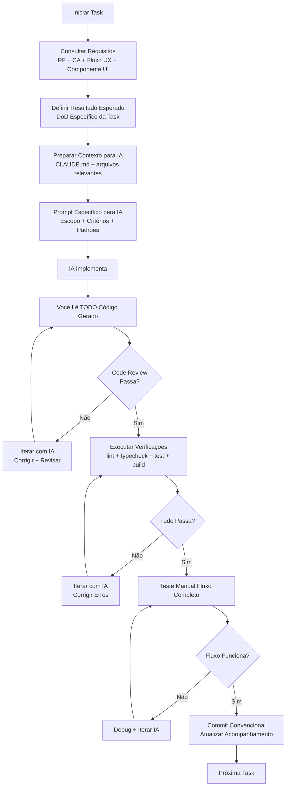

# ETAPA 10 — Desenvolver o Software por Partes

## Objetivo

Implementar o produto de forma **incremental e controlada**, feature por feature, usando IA de forma eficaz: contexto claro → implementação delimitada → revisão rigorosa → validação → registro.

## Por que esta etapa existe?

Vibe coding sem processo gera código inconsistente, bugs silenciosos, features pela metade e dívida técnica imediata. Um fluxo repetível por feature garante qualidade e rastreabilidade.

## Quando começar

- ETAPA 09 concluída (Ambiente 100% funcional, Plano de Implementação aprovado, CLAUDE.md pronto)
- Você sabe a próxima task do plano (ex: T1.1 Webhook WhatsApp)

## O que você precisa fazer

**Para CADA task do Plano de Implementação (repita este ciclo):**

1. **Consulte os requisitos** — RF, CA, fluxo UX, componente UI correspondentes
2. **Defina o resultado esperado** — o que "pronto" significa para esta task (DoD)
3. **Prepare o contexto para IA** — reúna arquivos relevantes, abra CLAUDE.md
4. **Solicite a implementação** — prompt específico, escopo delimitado, critérios claros
5. **Examine as alterações** — leia TODO código gerado, não apenas resumo
6. **Execute as verificações necessárias** — lint, typecheck, testes, build, manual
7. **Corrija falhas** — itere com IA até passar em tudo
8. **Confirme critérios de aceitação** — teste manual o fluxo completo
9. **Registre o resultado** — commit convencional, atualize Acompanhamento, decisões
10. **Avance para a próxima task** — só após DoD completo

## Quem faz o quê

| Atividade | Responsável |
|-----------|-------------|
| Selecionar próxima task do plano | 👤 USUÁRIO |
| Preparar contexto (arquivos, requisitos) | 👤 USUÁRIO + 🤖 IA |
| Implementar código | 🤖 IA (você dirige) |
| Revisar código gerado | 👤 USUÁRIO (obrigatório — leia tudo) |
| Executar verificações (lint, test, build) | ✅ VALIDAÇÃO (você roda comandos) |
| Testar fluxo manualmente | 👤 USUÁRIO |
| Corrigir falhas (iterar com IA) | 🤖 IA + 👤 USUÁRIO |
| Confirmar DoD | ✅ VALIDAÇÃO (você) |
| Commit + registro | 👤 USUÁRIO (IA pode sugerir msg) |
| Atualizar Acompanhamento + Decisões | 👤 USUÁRIO |

## Ferramentas recomendadas

- **Claude Code** — implementação, revisão, correção
- **Terminal** — `pnpm dev`, `pnpm build`, `pnpm lint`, `pnpm test`, `pnpm test:e2e`
- **Git** — commits convencionais, branches por feature
- **VS Code** — leitura de código, debug, Git integration
- **Playwright UI** — debug de testes e2e
- **Prisma Studio** — verificação de dados

## Fluxo de Trabalho por Feature (O Ciclo)



## Como preparar contexto para IA (por task)

**Arquivos mínimos a incluir no contexto (use `@arquivo` no Claude Code):**

| Arquivo | Por quê |
|---------|---------|
| `CLAUDE.md` | Contexto global do projeto |
| `.claude/context/requirements.md` | Requisitos + CA da feature |
| `.claude/context/components.md` | Componentes UI envolvidos (props, estados) |
| `.claude/context/api-patterns.md` | Padrões de API a seguir |
| `.claude/context/db-patterns.md` | Padrões Prisma a seguir |
| `app/api/.../route.ts` (existente) | Padrão real do código base |
| `components/...` (existentes) | Padrão real de componentes |
| `prisma/schema.prisma` | Modelo de dados atual |

> [!tip]
> **Não jogue tudo no contexto.** Seja cirúrgico: só arquivos relevantes para a task. Contexto demais = IA confusa.

## Modelo de Prompt por Task

```markdown
# Prompt para Task T{ID}: {Descrição Curta}

## Contexto da Task
- **Objetivo:** {O que esta task deve entregar — 1 frase}
- **Requisitos:** RF-XXX, CA-XXX (link ou cole trecho relevante)
- **Fluxo UX:** {Referência ao fluxo da ETAPA 06}
- **Componentes UI:** {Lista do Inventário/Registro ETAPA 08}
- **DoD desta Task:** {Critérios específicos além do DoD geral}

## Arquivos a Criar/Modificar
- `app/api/.../route.ts` — {descrição}
- `components/.../...tsx` — {descrição}
- `lib/validations/...ts` — {se novo schema}
- `prisma/schema.prisma` — {se migração}

## Padrões a Seguir (Obrigatório)
- API: Zod validation no topo, ApiError para erros, NextResponse.json
- Componentes: shadcn/ui base, tokens da Direção Visual, Server Components default
- DB: Prisma patterns (`.claude/context/db-patterns.md`)
- Testes: Vitest unit + Playwright e2e (se aplicável)
- TypeScript strict, ESLint/Prettier passam

## O que NÃO Fazer
- Não crie componentes duplicados — verifique `components/ui/` e `components/{domain}/`
- Não use `any` — tipifique corretamente
- Não faça fetch no cliente para APIs internas
- Não ignore estados de loading/error/vazio
- Não pule testes

## Formato de Resposta Esperado
1. Lista de arquivos criados/modificados (caminho + descrição breve)
2. Código completo de cada arquivo (um por bloco)
3. Comandos para testar/verificar
4. Notas sobre decisões tomadas ou dúvidas
```

## Verificações Obrigatórias por Task (Execute na Ordem)

```bash
# 1. TypeScript
pnpm typecheck

# 2. Lint + Format
pnpm lint

# 3. Testes Unitários/Integration (Vitest)
pnpm test

# 4. Build Produção
pnpm build

# 5. Testes E2E (Playwright) - se task envolve UI/fluxo
pnpm test:e2e

# 6. Teste Manual (Smoke Test)
# Abra pnpm dev → navegue no fluxo → confirme comportamento
```

> [!warning]
> **Não pule nenhuma verificação.** "A IA disse que passou" não conta. Você deve rodar e ver passar.

## Regras de Controle de Versão

| Regra | Descrição |
|-------|-----------|
| Branch por task | `feature/T{ID}-{slug}` ou `fix/T{ID}-{slug}` |
| Commit por task (mínimo) | 1 commit por task concluída (pode ter WIP intermediários) |
| Mensagem convencional | `feat: T1.1 webhook whatsapp recebe pedido` / `fix: T1.3 valida transição status` |
| Push + PR | Push branch → abra PR → CI passa → você revisa → merge squash → delete branch |
| Main sempre deployável | `main` = última versão estável integrada |

## Registro de Decisões Técnicas (Durante Implementação)

**Quando registrar:** Sempre que tomar decisão não prevista nos ADRs/Plano.
**Onde:** `05 - Desenvolvimento/Registro de Decisões Técnicas.md` (modelo em Modelos)
**Formato:**
```markdown
## {Data} - Task T{ID}: {Título}

**Contexto:** {O que estava fazendo}
**Decisão:** {O que decidiu}
**Alternativas:** {O que considerou}
**Justificativa:** {Por que escolheu}
**Impacto:** {Arquivos afetados, riscos, migrações futuras}
**ADR Relacionado:** {Se gerar novo ADR}
```

## Como lidar com erros da IA

| Tipo de Erro | Ação |
|--------------|------|
| Código não compila (TS error) | Cole erro → "Corrija este erro TypeScript: [erro]" |
| Lint falha | "Corrija ESLint: [erro]" |
| Teste falha | "Teste falhou: [output]. Corrija implementação para passar." |
| Comportamento errado (manual) | "Fluxo X não funciona: [descreva esperado vs atual]. Corrija." |
| IA ignora padrão | "Você não seguiu o padrão Y: [cole padrão]. Refazer seguindo." |
| IA cria arquivo duplicado | "Já existe `components/ui/Button.tsx`. Use/estenda ele, não crie novo." |

## Checklist de Execução (Por Task)

- [ ] Task selecionada do Plano de Implementação
- [ ] Requisitos, CA, Fluxo UX, Componentes UI consultados
- [ ] DoD específico da task definido
- [ ] Contexto preparado (arquivos @ no Claude Code)
- [ ] Prompt específico enviado para IA
- [ ] **TODO código gerado lido por você** (não só resumo)
- [ ] `pnpm typecheck` passa
- [ ] `pnpm lint` passa
- [ ] `pnpm test` passa
- [ ] `pnpm build` passa
- [ ] `pnpm test:e2e` passa (se aplicável)
- [ ] Teste manual do fluxo completo funciona
- [ ] Commit convencional feito
- [ ] Acompanhamento.md atualizado (task concluída)
- [ ] Registro de Decisões atualizado (se decisão nova)
- [ ] Contexto IA atualizado (se novo padrão surgiu)

## Critérios de Conclusão (Da Etapa Inteira)

- [ ] **Todas as tasks do Plano de Implementação concluídas** (DoD atendido)
- [ ] Suite completa de testes passa (`pnpm test` + `pnpm test:e2e`)
- [ ] Build de produção passa (`pnpm build`)
- [ ] Lint + TypeCheck limpos (`pnpm lint` + `pnpm typecheck`)
- [ ] Zero vulnerabilidades conhecidas (`pnpm audit`)
- [ ] Acompanhamento.md reflete 100% das tasks concluídas
- [ ] Registro de Decisões Técnicas completo
- [ ] Contexto IA (CLAUDE.md + .claude/context/) atualizado com padrões finais

## Verificações e Testes

- **Teste de regressão:** Rode suite completa após cada 3-4 tasks
- **Teste de integração real:** Teste fluxos cross-feature (ex: pedido → resposta → histórico)
- **Teste de performance:** Lighthouse em páginas principais > 90
- **Teste de acessibilidade:** `axe-core` zero violations em páginas críticas

## Erros comuns

| Erro | Como evitar |
|------|-------------|
| Aceitar código sem ler | **Regra inegociável:** Você lê TODO arquivo gerado antes de testar |
| Pular verificação "porque a IA disse que passa" | Você RODA os comandos. Sempre. |
| Task grande demais (não cabe no contexto) | Divida no Plano. Task = 1-3h, 1-3 arquivos, 1 feature vertical. |
| Contexto IA fica desatualizado | Atualize `.claude/context/` quando novo padrão surge |
| Scope creep dentro da task | DoD da task é lei. Nova ideia = nova task no plano (ou Won't). |
| Commits bagunçados | 1 task = 1 commit final (squash WIPs). Convencional Commits. |

## Se algo der errado

| Situação | Ação |
|----------|------|
| IA trava em loop de erro | Pare. Releia código. Identifique causa raiz. Reescreva prompt mais específico. |
| Teste e2e flaky | Isole. Rode 3x. Se flaky, corrija teste (wait, selector) ou implementação (race condition). |
| Build passa mas runtime erra | Adicione teste unit/integration para o caso. TypeScript não pega tudo. |
| Muitas tasks, perde o foco | Foque na PRÓXIMA task do plano. Não olhe o todo. |
| Decisão técnica afeta tasks anteriores | Registre no Registro de Decisões. Avalie impacto. Refatore se necessário (nova task). |

## Condições para avançar

- ✅ Todas as tasks do Plano de Implementação concluídas com DoD
- ✅ Suite completa de testes passa
- ✅ Build + Lint + TypeCheck limpos
- ✅ Acompanhamento e Registro de Decisões atualizados
- ✅ Contexto IA reflete estado final do código

## Próxima etapa

[[ETAPA 11 - Executar Testes e Garantir a Qualidade]]

## Materiais relacionados

- [[02 - Modelos/Desenvolvimento/Registro de Decisões Técnicas]]
- [[03 - Guias Práticos/Vibe Coding/Fluxo de Trabalho por Feature]]
- [[03 - Guias Práticos/Vibe Coding/Como Revisar Código Gerado por IA]]
- [[03 - Guias Práticos/Vibe Coding/Prompts para Implementação]]
- [[04 - Referência/Glossário/Vertical Slice]]
- [[04 - Referência/Glossário/Definition of Done]]