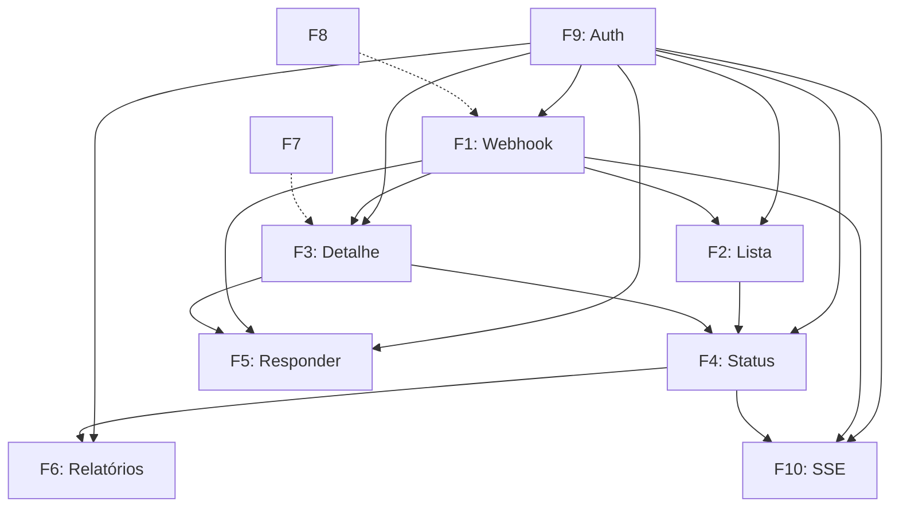

# Priorização de Funcionalidades

> **Copie para:** `05 - Projetos/SeuProjeto/02 - Produto/Priorização de Funcionalidades.md`
> Baseado na ETAPA 03-04. **Matriz MoSCoW + RICE + Dependências** para decisões de escopo.

---

## Visão Geral

| Método | Uso |
|--------|-----|
| **MoSCoW** | Classificação obrigatória (Must/Should/Could/Won't) |
| **RICE** | Priorização quantitativa para ordenar Within MoSCoW |
| **Dependências** | Sequenciamento técnico (o que bloqueia o quê) |

> **Regra:** Todo item **Must** entra no MVP. **Should** entra se houver capacidade. **Could** só se sobrar tempo. **Won't** documentado explicitamente.

---

## Matriz MoSCoW (MVP v1)

### MUST (Crítico - MVP não funciona sem)
| ID | Funcionalidade | RICE Score | Esforço (dias) | Dependências | Sprint |
|----|----------------|------------|----------------|--------------|--------|
| F1 | Receber pedidos via WhatsApp Webhook | 480 | 4 | Meta account, Neon | 1 |
| F2 | Lista de pedidos com status | 420 | 2 | F1 | 1 |
| F3 | Detalhes do pedido | 390 | 2 | F1 | 1 |
| F4 | Atualizar status (botões rápidos) | 450 | 1 | F2, F3 | 1 |
| F9 | Autenticação (Magic Link + Credentials) | 500 | 3 | Resend, NextAuth | 0 |

### SHOULD (Importante - MVP incompleto sem)
| ID | Funcionalidade | RICE Score | Esforço | Dependências | Sprint |
|----|----------------|------------|---------|--------------|--------|
| F5 | Responder cliente via app (templates + custom) | 360 | 3 | F1, Meta templates | 2 |
| F6 | Relatório diário/semanal simples | 280 | 2 | F2, F4 | 2 |
| F10 | Tempo real (SSE) - novos pedidos/atualizações | 400 | 3 | F1, F4 | 1 |

### COULD (Nice to have - só se sobrar)
| ID | Funcionalidade | RICE Score | Esforço | Dependências | Sprint |
|----|----------------|------------|---------|--------------|--------|
| F7 | Cadastro básico de produtos/preços | 200 | 2 | - | 2 |
| F8 | Configuração de horário de funcionamento | 180 | 1 | - | 2 |

### WON'T v1 (Explícito - Fora do Escopo)
| ID | Funcionalidade | Motivo | Reavaliar |
|----|----------------|--------|-----------|
| W1 | Múltiplos estabelecimentos/filiais | Multi-tenant complexo | v1.2 |
| W2 | Gestão de estoque avançada | Baixa automática, alertas, fornecedores | v1.3 |
| W3 | Integração iFood / Rappi / Marketplaces | APIs diferentes, compliance | v1.3 |
| W4 | Painel administrativo web separado | Mobile-first basta v1 | v2.0 |
| W5 | Relatórios avançados (ABC, curva, ticket médio) | Complexidade BI | v1.1 |
| W6 | Programa de fidelidade / Cupons | Regra complexa, não validada | Icebox |
| W7 | Múltiplos usuários com perfis (admin, cozinha, caixa) | RBAC complexo | v1.2 |
| W8 | API pública para terceiros | Segurança, versionamento, suporte | v2.0 |
| W9 | Pagamentos integrados (PIX, Cartão) | PCI-DSS, risco financeiro | Icebox |
| W10 | Notificações push nativas (App Store) | Requer app nativo | v1.2 PWA |
| W11 | Modo offline completo (IndexedDB + sync) | Complexidade alta | Icebox |
| W12 | Multi-idioma / i18n | Público 100% BR | v2.0 |
| W13 | Tema escuro / personalização visual | Nice to have | v1.1 |
| W14 | Webhooks de saída | Não solicitado | Icebox |
| W15 | Logs de auditoria avançados (SIEM) | Não regulado | v2.0 |

---

## Cálculo RICE (Reach × Impact × Confidence / Effort)

| Fator | Escala | Como Estimar |
|-------|--------|--------------|
| **Reach** | Usuários/semana afetados | Quantos lojistas usam por semana |
| **Impact** | 0.25 (mín) a 3 (máx) | Quão move métrica principal (pedidos processados) |
| **Confidence** | 0% a 100% | Evidência: validação usuário, protótipo, intuição |
| **Effort** | Dias de trabalho (1 pessoa) | Estimativa realista com buffer |

### Exemplo Cálculo

| Feature | Reach (semana) | Impact | Confidence | Effort (dias) | RICE |
|---------|----------------|--------|------------|---------------|------|
| F1 Webhook | 100% (todos) | 3 (core) | 90% | 4 | 100×3×0.9/4 = **67.5** |
| F4 Status | 100% | 3 | 95% | 1 | 100×3×0.95/1 = **285** |
| F7 Produtos | 60% | 1.5 | 70% | 2 | 60×1.5×0.7/2 = **31.5** |
| F8 Horários | 80% | 1 | 80% | 1 | 80×1×0.8/1 = **64** |

> **Nota:** RICE normalizado para comparação relativa. Use para ordenar **dentro** de cada bucket MoSCoW.

---

## Mapa de Dependências (Grafo)



**Legenda:** `→` = bloqueia (precisa estar pronto) | `-.->` = opcional (melhora mas não bloqueia)

### Ordem de Implementação Sugerida (Topológica)

1. **Sprint 0:** F9 (Auth) — base para tudo
2. **Sprint 1:** F1 (Webhook) → F2 (Lista) → F3 (Detalhe) → F4 (Status) → F10 (SSE)
3. **Sprint 2:** F5 (Responder) → F6 (Relatórios) → F7 (Produtos) → F8 (Horários)

---

## Critérios de Decisão (Quando Dúvida)

| Pergunta | Se SIM → | Se NÃO → |
|----------|----------|----------|
| Valida hipótese principal (H1/H2)? | Priorizar | Rebaixar para Could/Won't |
| Usuário real pediu? | Priorizar | Rebaixar |
| Bloqueia outra feature Must? | Priorizar (desbloquear) | Agendar depois |
| Esforço > 3 dias? | Dividir em menores | Reavaliar escopo |
| Introduz dependência externa nova? | Evitar no MVP | Aceitar se Must |
| Sem isso o MVP é inútil? | Must | Should/Could |

---

## Template de Decisão de Priorização (Para Novas Ideias)

> **Use sempre que surgir nova feature/ideia durante desenvolvimento**

```markdown
## Nova Ideia: [Nome]

**Descrição:** [O que faz]
**Origem:** [Usuário real / Hipótese / Concorrente / Ideia interna]
**MoSCoW Proposto:** [Must/Should/Could/Won't]

### RICE
- Reach: [X usuários/semana]
- Impact: [0.25-3]
- Confidence: [0-100%]
- Effort: [Y dias]
- **Score: [Calculado]**

### Dependências
- Bloqueia: [IDs]
- Bloqueado por: [IDs]

### Validação
- [ ] Entrevista usuário confirmou necessidade?
- [ ] Protótipo testado?
- [ ] Métrica de sucesso definida?

### Decisão
- [ ] Aprovado para [Sprint X]
- [ ] Rebaixado para [Could/Won't]
- [ ] Icebox (revisar em [data])

**Decisor:** [Nome] | **Data:** [YYYY-MM-DD]
```

---

## Revisão de Priorização (Semanal)

- [ ] Nova ideia surgiu? → Aplicar template acima
- [ ] Feature Must ficou mais complexa? → Dividir? Cortar? Adiar?
- [ ] Dependência externa mudou? → Impacto no escopo?
- [ ] Feedback usuário contradiz prioridade? → Decidir: pivotar ou manter
- [ ] Prazo apertando? → Cortar Could → Should → **NUNCA corte Must**

---

## Checklist de Priorização (Validação ETAPA 03-04)

- [ ] Todas features Mapeadas (Must + Should + Could + Won't)
- [ ] RICE calculado para ordenação relativa
- [ ] Dependências mapeadas (grafo + ordem topológica)
- [ ] Won't v1 documentado explicitamente (protege contra scope creep)
- [ ] Critérios de decisão claros para novas ideias
- [ ] Template de decisão para uso contínuo
- [ ] Revisão semanal agendada

---

## Próxima Etapa
[[02 - Modelos/Pesquisa e Planejamento/Definição do Problema]] (já criado) ou [[02 - Modelos/Requisitos e Arquitetura/Requisitos Funcionais]] (já criado)

---

## Materiais Relacionados
- [[01 - Manual de Desenvolvimento/02 - Produto e Requisitos/ETAPA 03 - Definir o Produto e seu Escopo]]
- [[01 - Manual de Desenvolvimento/02 - Produto e Requisitos/ETAPA 04 - Organizar os Requisitos]]
- [[02 - Modelos/Pesquisa e Planejamento/Definição do Produto]]
- [[02 - Modelos/Pesquisa e Planejamento/Escopo e Limites]]
- [[02 - Modelos/Requisitos e Arquitetura/Requisitos Funcionais]]
- [[04 - Referência/Glossário/MoSCoW]]
- [[04 - Referência/Glossário/RICE]]
- [[04 - Referência/Glossário/Scope Creep]]