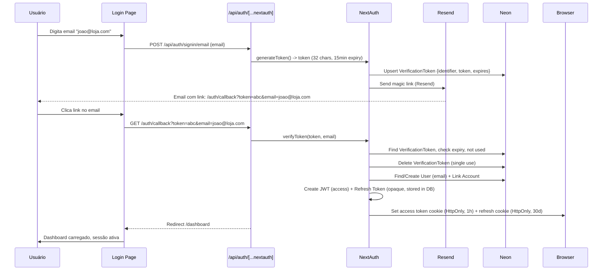
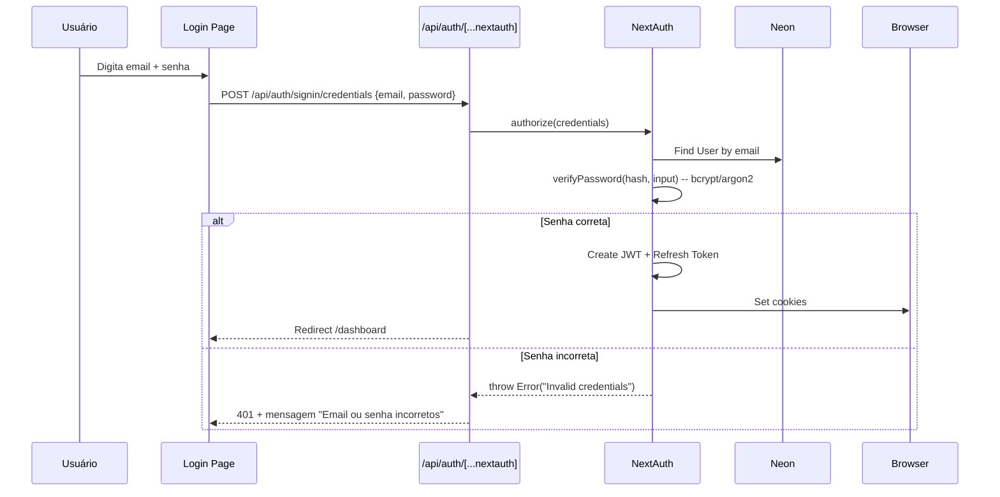

# Estratégia de Auth

> **Copie para:** `05 - Projetos/SeuProjeto/03 - Arquitetura/Estratégia de Auth.md`
> Baseado na ETAPA 05. **Autenticação, autorização, sessão, segurança.**

---

## Visão Geral

| Aspecto | Decisão |
|---------|---------|
| **Provedor** | NextAuth.js v5 (Auth.js) |
| **Estratégias** | Magic Link (Email) + Credentials (Email/Senha) |
| **Session Strategy** | JWT (stateless) com Refresh Token rotation no banco |
| **Token Storage** | HttpOnly; Secure; SameSite=Lax cookies |
| **Proteção Rotas** | Middleware Next.js (matcher: `/dashboard/:path*`, `/api/:path*`) |
| **Rate Limit Auth** | 30 req/min/IP (login, magic link request, callback) |

---

## Fluxo: Magic Link (Primário)



### Detalhes Magic Link
- **Token:** 32 chars URL-safe (crypto.randomBytes)
- **Expiração:** 15 minutos (config `NEXTAUTH_MAGIC_LINK_EXPIRY=900`)
- **Uso único:** Deletado após verificação bem-sucedida
- **Email:** Resend, template HTML + texto, subject "Seu link de acesso ao PedidosSimples"
- **Callback:** `/auth/callback` (página server-side que processa e redireciona)

---

## Fluxo: Credentials (Email/Senha) - Secundário



### Detalhes Credentials
- **Hash:** Argon2id (via `@node-rs/argon2` ou `bcryptjs` fallback)
- **Registro senha:** Opcional no primeiro login (Magic Link → definir senha depois)
- **Reset senha:** Fluxo Magic Link "Esqueci senha" → define nova senha
- **Proteção:** Rate limit 5 tentativas/15min por email/IP

---

## Estrutura de Tokens

### Access Token (JWT - NextAuth)
```typescript
// Payload JWT (NextAuth default + custom)
interface JWTPayload {
  sub: string;           // user.id
  email: string;         // user.email
  name?: string;         // user.nome
  role: string;          // user.role (OWNER/FUNCIONARIO)
  lojaId: string;        // user.lojaId
  iat: number;           // issued at
  exp: number;           // expires at (1 hora)
  jti: string;           // JWT ID (para revogação se necessário)
}
```
- **Expiração:** 1 hora (config `NEXTAUTH_JWT_EXPIRY=3600`)
- **Assinatura:** HS256 com `NEXTAUTH_SECRET` (32+ chars, gerado `openssl rand -base64 32`)
- **Renovação:** Automática via Refresh Token (silenciosa)

### Refresh Token (Opaque - Banco de Dados)
```prisma
model RefreshToken {
  id        String   @id @default(cuid())
  tokenHash String   @unique // hash do token (bcrypt)
  userId    String
  user      Usuario  @relation(fields: [userId], references: [id], onDelete: Cascade)
  userAgent String?  // Para debug/revogação seletiva
  ip        String?  // Para auditoria
  expiresAt DateTime // 30 dias
  createdAt DateTime @default(now())
  revokedAt DateTime?
  
  @@index([userId])
  @@index([expiresAt])
}
```
- **Rotação:** A cada uso, novo refresh token gerado, antigo revogado (`revokedAt = now()`)
- **Expiração:** 30 dias (config `REFRESH_TOKEN_EXPIRY_DAYS=30`)
- **Máximo sessões:** 5 por usuário (RN-021) - LRU removal
- **Revogação:** Logout, mudança senha, admin, expiração

---

## Middleware de Proteção (`middleware.ts`)

```typescript
// matcher: ['/dashboard/:path*', '/api/:path*']
export async function middleware(req: NextRequest) {
  // 1. Rate limit auth endpoints
  if (req.nextUrl.pathname.startsWith('/api/auth/')) {
    const rateLimited = await checkRateLimit(req.ip, 'auth', 30, 60_000);
    if (rateLimited) return new Response('Too Many Requests', { status: 429 });
  }
  
  // 2. Verificar sessão (NextAuth getToken)
  const token = await getToken({ req, secret: process.env.NEXTAUTH_SECRET });
  
  // 3. Rotas públicas (login, callback, webhook, health)
  const publicPaths = ['/login', '/auth/callback', '/api/webhook', '/api/health'];
  if (publicPaths.some(p => req.nextUrl.pathname.startsWith(p))) {
    return NextResponse.next();
  }
  
  // 4. Se não autenticado → redirect login com callbackUrl
  if (!token) {
    const loginUrl = new URL('/login', req.url);
    loginUrl.searchParams.set('callbackUrl', req.nextUrl.pathname);
    return NextResponse.redirect(loginUrl);
  }
  
  // 5. Headers de segurança
  const res = NextResponse.next();
  res.headers.set('X-Frame-Options', 'DENY');
  res.headers.set('X-Content-Type-Options', 'nosniff');
  res.headers.set('Referrer-Policy', 'strict-origin-when-cross-origin');
  res.headers.set('Permissions-Policy', 'camera=(), microphone=(), geolocation=()');
  // CSP via next.config.js (mais robusto)
  
  return res;
}
```

---

## Autorização (RBAC Simples v1)

| Role | Permissões |
|------|------------|
| `OWNER` | Acesso total: pedidos, relatórios, configurações, usuários, exclusão conta |
| `FUNCIONARIO` | Pedidos (ver, atualizar status, responder), relatórios (ver), **NÃO**: configurações, usuários, exclusão |

```typescript
// src/lib/auth.ts
export function requireRole(token: JWT, allowedRoles: string[]) {
  if (!allowedRoles.includes(token.role)) {
    throw new Error('FORBIDDEN'); // Middleware/API trata -> 403
  }
}

// Uso em Server Actions
export async function updateStatus(pedidoId: string, status: PedidoStatus) {
  const session = await getServerSession();
  requireRole(session.user, ['OWNER', 'FUNCIONARIO']);
  // ... lógica
}
```

---

## Segurança Adicional

### Headers de Segurança (next.config.js)
```javascript
const securityHeaders = [
  {
    key: 'Content-Security-Policy',
    value: [
      "default-src 'self'",
      "script-src 'self' 'unsafe-eval' 'unsafe-inline'", // Next.js precisa
      "style-src 'self' 'unsafe-inline'", // Tailwind
      "img-src 'self' data: blob: https://*.vercel.app https://*.public.blob.vercel-storage.com",
      "font-src 'self' data:",
      "connect-src 'self' https://*.vercel.app wss://*.vercel.app https://graph.facebook.com https://api.resend.com",
      "frame-ancestors 'none'",
      "base-uri 'self'",
      "form-action 'self'",
    ].join('; '),
  },
  { key: 'Strict-Transport-Security', value: 'max-age=31536000; includeSubDomains; preload' },
  { key: 'X-Frame-Options', value: 'DENY' },
  { key: 'X-Content-Type-Options', value: 'nosniff' },
  { key: 'Referrer-Policy', value: 'strict-origin-when-cross-origin' },
  { key: 'Permissions-Policy', value: 'camera=(), microphone=(), geolocation=()' },
];
```

### Proteção CSRF
- NextAuth v5: CSRF protection built-in para callbacks
- Forms customizados: `csrfToken` via `getServerSession()` + hidden input
- APIs mutantes: Verificar `Origin`/`Referer` header + SameSite=Lax cookies

### Prevenção de Enumeração de Usuário
- Login falho: **sempre** "Email ou senha incorretos" (mesmo se email não existe)
- Magic Link: **sempre** "Verifique seu email" (mesmo se email não cadastrado)
- Registro: Mesmo fluxo Magic Link (cria usuário se não existe)

---

## LGPD e Auth

| Requisito | Implementação |
|-----------|---------------|
| **Consentimento** | Checkbox "Aceito termos e política" no primeiro Magic Link (salva em `ConsentimentoLGPD`) |
| **Acesso dados** | Endpoint `/api/user/data` → exporta todos dados do usuário (pedidos anonimizados se solicitado) |
| **Exclusão conta** | `/api/user/delete` → anonimiza (mantém pedidos fiscais, remove PII), revoga tokens, marca `deletedAt` |
| **Portabilidade** | JSON export com estrutura documentada |
| **Retenção logs auth** | 1 ano (login, logout, falhas, refresh) |
| **Minimização** | Não coletar nome obrigatório, só email + loja |

---

## Testes de Auth (Critérios)

| Cenário | Ferramenta | Critério Pass |
|---------|------------|---------------|
| Magic Link enviado < 30s | Playwright + Resend mock | Email recebido, link válido |
| Magic Link expira 15min | Unit (JWT exp) | Token rejeitado após 15min |
| Magic Link uso único | Integration | 2º uso → erro "Link já utilizado" |
| Credentials login sucesso | Playwright | Redireciona dashboard, cookies setados |
| Credentials falha genérica | Playwright | Mensagem "Email ou senha incorretos" para ambos casos |
| Refresh token rotation | Unit/Integration | Novo token a cada request, antigo revogado |
| Logout invalida refresh | Integration | Refresh após logout → 401 |
| Rate limit login | Load test (k6) | 31º request/min → 429 |
| Middleware protege /dashboard | Playwright | Sem login → redirect /login?callbackUrl=... |
| RBAC FUNCIONARIO bloqueia config | Playwright | 403 em /configuracoes |
| Session expira 1h | Integration (time travel) | Após 1h + 1 request → refresh automático |

---

## Variáveis de Ambiente (Auth)

```env
# NextAuth
NEXTAUTH_SECRET="openssl rand -base64 32"  # 32+ chars, mesmo em preview/prod
NEXTAUTH_URL="https://app.seudominio.com"  # Canonical URL
NEXTAUTH_JWT_EXPIRY="3600"                 # 1 hora (segundos)
NEXTAUTH_MAGIC_LINK_EXPIRY="900"           # 15 min (segundos)

# Refresh Token
REFRESH_TOKEN_EXPIRY_DAYS="30"
MAX_SESSIONS_PER_USER="5"

# Resend (Magic Link email)
RESEND_API_KEY="re_..."
EMAIL_FROM="PedidosSimples <noreply@seudominio.com>"
MAGIC_LINK_URL="https://app.seudominio.com/auth/callback"

# Rate Limit (Redis/Vercel KV se necessário, ou in-memory com limitação)
RATE_LIMIT_AUTH_MAX="30"
RATE_LIMIT_AUTH_WINDOW_MS="60000"
```

---

## Checklist de Implementação Auth

- [ ] NextAuth v5 configurado com providers: `email` (nodemailer/Resend) + `credentials`
- [ ] `pages: { signIn: '/login', error: '/login' }` customizadas
- [ ] `callbacks: { jwt, session, signIn }` implementados (lojaId, role no token)
- [ ] `events: { createUser, linkAccount, signIn, signOut }` para auditoria
- [ ] `adapter: PrismaAdapter` (NextAuth Prisma Adapter) para usuários/accounts/sessions
- [ ] Tabela `RefreshToken` no Prisma + rotação implementada
- [ ] Middleware `middleware.ts` com matcher + rate limit + security headers
- [ ] Página `/login` com formulário Magic Link + Credentials (tabs)
- [ ] Página `/auth/callback` processa token + redireciona
- [ ] Componente `SessionProvider` no layout raiz
- [ ] Hook `useSession()` / `getServerSession()` funcionando
- [ ] Testes: Unit (callbacks), Integration (fluxos), E2E (Playwright login/logout)
- [ ] Documentação: Como trocar segredo, como revogar sessões, como debug

---

## Próxima Etapa
[[02 - Modelos/UX e UI/Jornada do Usuário]]

---

## Materiais Relacionados
- [[01 - Manual de Desenvolvimento/03 - Arquitetura e Planejamento/ETAPA 05 - Planejar a Arquitetura e a Solução Técnica]]
- [[02 - Modelos/Requisitos e Arquitetura/Visão Técnica]]
- [[02 - Modelos/Requisitos e Arquitetura/Modelo de Dados]]
- [[02 - Modelos/Requisitos e Arquitetura/Registro de Integrações]]
- [[02 - Modelos/UX e UI/Jornada do Usuário]]
- [[04 - Referência/Glossário/NextAuth]]
- [[04 - Referência/Glossário/JWT]]
- [[04 - Referência/Glossário/Refresh Token]]
- [[04 - Referência/Glossário/RBAC]]
- [[04 - Referência/Glossário/LGPD]]