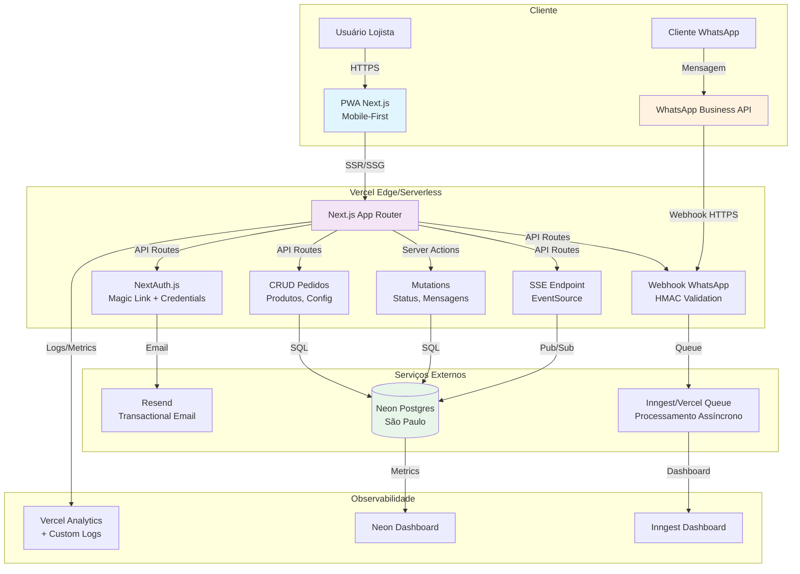
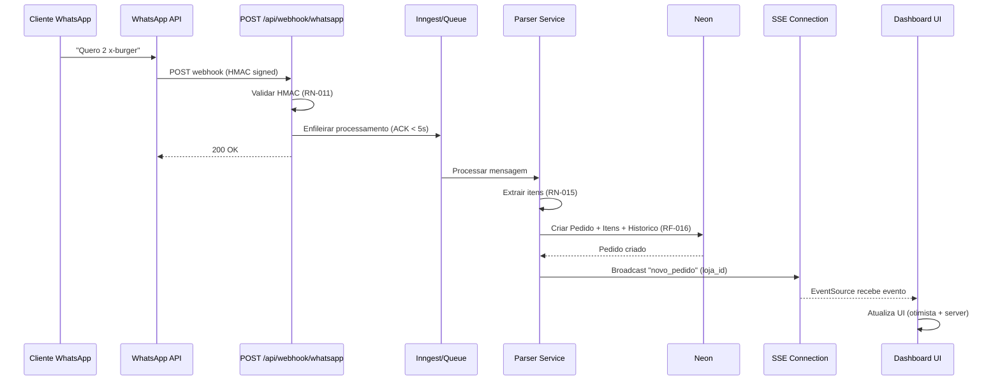
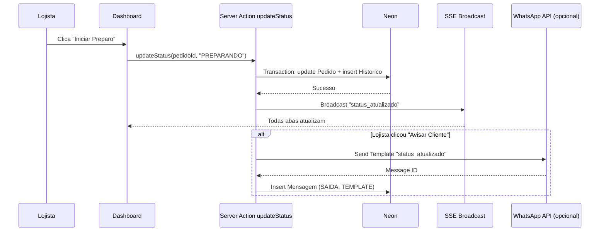

# Visão Técnica

> **Copie para:** `05 - Projetos/SeuProjeto/03 - Arquitetura/Visão Técnica.md`
> Baseado na ETAPA 05. Visão arquitetural de alto nível (diagrama + decisões-chave).

---

## Visão Geral da Arquitetura



---

## Princípios Arquiteturais

| Princípio | Aplicação no Projeto |
|-----------|---------------------|
| **Serverless First** | Zero servers gerenciados. Vercel + Neon + Resend = managed services |
| **Type Safety End-to-End** | TypeScript strict + Prisma + Zod + OpenAPI = 0 `any` em produção |
| **Progressive Enhancement** | Funciona sem JS (SSR), melhora com JS (SSE, otimista UI) |
| **Mobile-First Real** | Design 375px primeiro. Touch targets 44px. PWA instalável. |
| **Privacy by Design** | LGPD nativo: consentimento, minimização, exclusão, anonimização |
| **Observability Built-in** | Logs estruturados, metrics, tracing desde o dia 1 |
| **Deploy = Merge** | `main` branch = production. Preview deployments em PRs. |
| **Cost-Aware** | Free tier até validar tração. Upgrade only when metrics demand. |

---

## Camadas da Aplicação

### 1. Presentation (Next.js App Router)
```
src/app/
├── (auth)/
│   ├── login/page.tsx           # Página login (Magic Link + Credentials)
│   └── callback/page.tsx        # Callback Magic Link
├── (dashboard)/
│   ├── layout.tsx               # Layout com sidebar, header, SSE provider
│   ├── page.tsx                 # Dashboard: lista pedidos (Server Component)
│   ├── pedidos/[id]/page.tsx    # Detalhe pedido (Client Component - SSE)
│   ├── relatorios/page.tsx      # Relatórios (Server Component)
│   └── configuracoes/
│       ├── produtos/page.tsx    # CRUD Produtos
│       └── horarios/page.tsx    # Config Horários
├── api/
│   ├── auth/[...nextauth]/route.ts
│   ├── webhook/whatsapp/route.ts
│   ├── events/route.ts          # SSE
│   ├── pedidos/route.ts         # GET/POST pedidos
│   ├── pedidos/[id]/route.ts    # GET/PATCH/DELETE pedido
│   ├── pedidos/[id]/status/route.ts  # PATCH status
│   ├── pedidos/[id]/mensagens/route.ts # POST mensagem
│   ├── produtos/route.ts
│   └── configuracoes/route.ts
└── globals.css                  # Tailwind + CSS Variables (design tokens)
```

### 2. Domain Logic (Server Actions + Services)
```
src/
├── actions/
│   ├── pedidos.ts               # createPedido, updateStatus, cancelar, enviarMensagem
│   ├── produtos.ts              # CRUD produtos
│   └── configuracoes.ts         # CRUD config/horários
├── services/
│   ├── whatsapp.ts              # WhatsApp API client (templates, envio, mídia)
│   ├── parser.ts                # Extração de pedidos de texto livre (RN-015)
│   ├── relatorios.ts            # Queries agregadas (diário, semanal)
│   ├── auth.ts                  # Helpers NextAuth (getSession, requireAuth)
│   └── sse.ts                   # Broadcast events (novo_pedido, status_atualizado)
├── lib/
│   ├── prisma.ts                # PrismaClient singleton
│   ├── validators.ts            # Zod schemas (input validation)
│   ├── utils.ts                 # Helpers (formatCurrency, normalizePhone, etc)
│   └── constants.ts             # Enums, config, feature flags
└── middleware.ts                # Auth protection, rate limit, security headers
```

### 3. Data Layer (Prisma + Neon)
- **Connection Pooling:** Neon PgBouncer built-in (`?pgbouncer=true`)
- **Middleware Prisma:** Soft delete (`deletedAt`), audit timestamps, JSON sync
- **Migrations:** `prisma migrate deploy` no CI/CD (Vercel build)

### 4. External Integrations
| Integração | Cliente | Padrão | Resiliência |
|------------|---------|--------|-------------|
| WhatsApp Cloud API | `src/services/whatsapp.ts` | REST + Webhook | Retry 3x exp backoff, circuit breaker, dead letter |
| Resend Email | `src/services/email.ts` | REST | Retry 2x, log falha, fallback log local |
| Vercel Blob | `src/services/storage.ts` | REST | Upload direto client-side (signed URL) |

---

## Fluxos Críticos

### Fluxo 1: Pedido via WhatsApp → Dashboard (Tempo Real)


### Fluxo 2: Mudança de Status → Tempo Real + Notificação Cliente


---

## Decisões Técnicas-Chave (Resumo ADRs)

| ADR | Decisão | Status |
|-----|---------|--------|
| ADR-001 | Stack: Next.js + Vercel + Neon + Prisma + NextAuth + SSE | ✅ Aceito |
| ADR-002 | Modelo de Dados: Schema Prisma normalizado com snapshot JSON | ✅ Aceito |
| ADR-003 | Auth: NextAuth v5 (Magic Link + Credentials), JWT strategy, refresh rotation | 📝 Proposto |
| ADR-004 | Tempo Real: SSE nativo (Route Handler) vs WebSocket/Pusher | 📝 Proposto |
| ADR-005 | Processamento Webhook: Assíncrono via Inngest/Vercel Queue | 📝 Proposto |
| ADR-006 | Parsing Pedido: Regex + heurísticas v1, LLM v1.1 se necessário | 📝 Proposto |
| ADR-007 | UI: Tailwind + shadcn/ui (Radix), design tokens CSS Variables | 📝 Proposto |
| ADR-008 | Testes: Vitest (unit/integration) + Playwright (E2E), CI no GitHub Actions | 📝 Proposto |
| ADR-009 | LGPD: Consentimento por tipo, soft delete, anonimização, retenção | 📝 Proposto |
| ADR-010 | Feature Flags: Config tabela + env vars, rollout gradual | 📝 Proposto |

---

## Não-Funcionais na Arquitetura

| RNF | Implementação Arquitetural |
|-----|---------------------------|
| **Performance** | SSR/ISR para páginas estáticas, Server Components por padrão, Client Components só onde interatividade necessária, SSE para push |
| **Segurança** | Middleware: auth check, rate limit, security headers (CSP, HSTS), HMAC webhook, Zod validation em todas APIs |
| **Confiabilidade** | Idempotência (whatsappMessageId unique), transações DB (status + historico), dead letter queue, health check endpoint |
| **Usabilidade** | Mobile-first CSS, PWA manifest + service worker, ARIA labels, focus management, loading states, otimistic UI |
| **Manutenibilidade** | TypeScript strict, ESLint + Prettier, testes automatizados, ADRs, OpenAPI docs, Prisma Studio |

---

## Riscos Técnicos e Mitigações

| Risco | Prob. | Impacto | Mitigação |
|-------|-------|---------|-----------|
| Neon cold start > 500ms | Média | Médio | Connection pooling, keep-warm cron (Vercel Cron 5min), `prisma.$connect()` no middleware |
| Vercel Function timeout (10s Hobby) | Alta | Alto | Webhook ACK síncrono < 5s, processamento pesado assíncrono (Inngest), upgrade Pro se necessário |
| SSE connections limit (Vercel) | Baixa | Médio | Heartbeat 30s, fechar se aba hidden > 5min, monitorar conexões ativas, upgrade Pro |
| WhatsApp API muda/quebra | Baixa | Crítico | Adapter pattern em `whatsapp.ts`, versionamento API, fallback email/template |
| Parser falha em pedidos complexos | Média | Médio | Dead letter + alerta, revisão manual, melhoria iterativa, LLM fallback v1.1 |
| LGPD compliance gaps | Baixa | Alto | Checklist LGPD na ETAPA 12, auditoria código, DPIA se necessário |

---

## Escalabilidade (Pós-MVP)

| Gatilho | Ação |
|---------|------|
| > 100 conexões SSE simultâneas | Upgrade Vercel Pro (60s function, mais CPU) ou migrar SSE para Pusher/Ably |
| > 500 pedidos/dia/loja | Neon Scale tier, read replicas, cache (Redis/Vercel KV) para lista dashboard |
| Multi-loja real (v1.2) | Row Level Security (RLS) no Postgres, `lojaId` em todas queries, onboarding self-service |
| Relatórios lentos | Materialized views, agregações pré-calculadas (cron noturno), ClickHouse/Apache Iceberg se BI real |
| Internacionalização | i18n routing Next.js, timezone por loja, moeda/localização por loja |

---

## Checklist de Validação da Arquitetura

- [ ] Diagrama de arquitetura desenhado e versionado
- [ ] ADRs para todas decisões estruturais (mínimo 5)
- [ ] Fluxos críticos mapeados com sequence diagrams
- [ ] Camadas separadas (presentation, domain, data, external)
- [ ] Princípios arquiteturais documentados e seguidos
- [ ] RNFs mapeados para implementação arquitetural
- [ ] Riscos técnicos identificados com mitigações
- [ ] Plano de escalabilidade pós-MVP esboçado

---

## Próxima Etapa
[[02 - Modelos/Requisitos e Arquitetura/Registro de Integrações]]

---

## Materiais Relacionados
- [[01 - Manual de Desenvolvimento/03 - Arquitetura e Planejamento/ETAPA 05 - Planejar a Arquitetura e a Solução Técnica]]
- [[02 - Modelos/Requisitos e Arquitetura/ADR - Registro de Decisões Arquiteturais]]
- [[02 - Modelos/Requisitos e Arquitetura/Modelo de Dados]]
- [[02 - Modelos/Requisitos e Arquitetura/Registro de Integrações]]
- [[02 - Modelos/Requisitos e Arquitetura/Estratégia de Auth]]
- [[05 - Projetos/Exemplo-PedidosSimples/03 - Arquitetura/ADR-001-stack-tecnologica]]
- [[05 - Projetos/Exemplo-PedidosSimples/03 - Arquitetura/ADR-002-modelo-de-dados]]
- [[04 - Referência/Glossário/Arquitetura Serverless]]
- [[04 - Referência/Glossário/SSE]]
- [[04 - Referência/Glossário/Type Safety]]