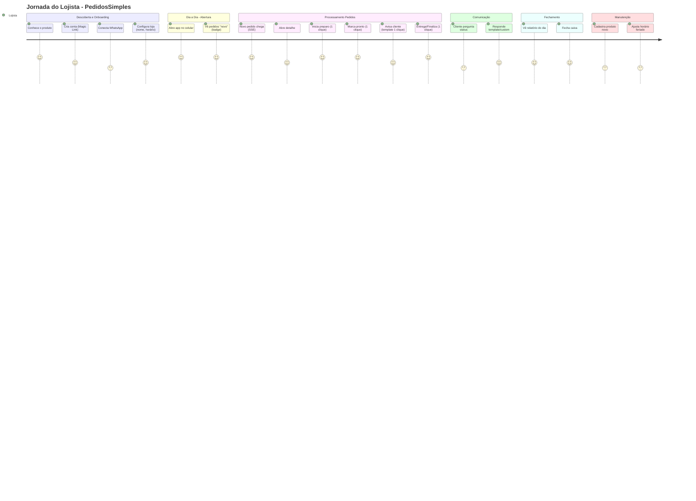
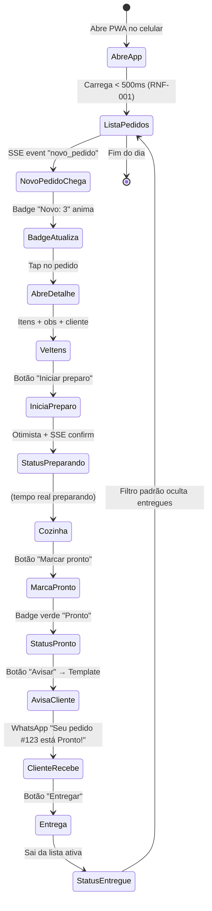

# Jornada do Usuário

> **Copie para:** `05 - Projetos/SeuProjeto/04 - UX e UI/Jornada do Usuário.md`
> Baseado na ETAPA 06. **Mapeamento completo da experiência do lojista** (principal) e cliente (secundário).

---

## Personas (Recap da ETAPA 03)

| Persona | Perfil | Objetivo Principal | Dor Principal |
|---------|--------|-------------------|---------------|
| **Dono(a) da Loja** | 30-50 anos, 1-2 funcionários, usa WhatsApp Business, não tem sistema formal | Organizar pedidos sem perder nenhum, responder rápido, fechar caixa no fim do dia | Perde pedidos no meio das conversas, não sabe status, responde lento, relatório manual |
| **Funcionário(a)** | 20-35 anos, usa celular da loja, menos autonomia | Ver o que está pendente, marcar pronto, avisar dono | Não sabe prioridade, comunicação falha com dono |

> **Foco v1:** Dono(a) da Loja (single user). Funcionário = v1.2 (multi-user).

---

## Jornada Principal: Dono(a) da Loja

### Mapa da Jornada (Visão Geral)

---

### Cenário 1: Primeiro Acesso (Onboarding)

| Etapa | Ação do Usuário | Sistema | Critério de Sucesso |
|-------|-----------------|---------|---------------------|
| 1 | Acessa landing page / indicação | Mostra valor prop + CTA "Começar grátis" | Entende proposta em < 10s |
| 2 | Clica "Começar" → página login | Formulário Magic Link (email) | Mobile-friendly, 1 campo |
| 3 | Digita email, envia | Envia email Resend < 30s | Email chega na inbox (não spam) |
| 4 | Abre email, clica link | Valida token, cria usuário+loja, redireciona /onboarding | Link expira 15min, uso único |
| 5 | /onboarding passo 1: Nome loja + telefone WhatsApp | Salva, valida E.164 | Telefone normalizado |
| 6 | /onboarding passo 2: Conectar WhatsApp Business | Mostra instruções + link Meta Business | Entende como pegar Phone Number ID + Token |
| 7 | /onboarding passo 3: Configurar horário | Preset "Lanchonete noite" + editar | Preset cobre 80% casos |
| 8 | /onboarding passo 4: Testar webhook | Botão "Enviar teste" → recebe pedido fake | Vê pedido "Teste" na lista |
| 9 | Finaliza → /dashboard | Dashboard vazio + toast "Pronto! Receba pedidos" | < 5 min total onboarding |

**Métrica Onboarding:** > 80% completam sem ajuda (RNF-036)

---

### Cenário 2: Dia Típico - Recebendo Pedidos

#### Detalhamento Tela a Tela

**Tela: Lista de Pedidos (`/dashboard`)**
- **Layout:** Mobile-first, lista vertical, cards compactos
- **Header:** Logo + Nome loja + Badge totais (Novo: 3 | Preparando: 2 | Pronto: 1)
- **Filtros:** Chips horizontais (Todos, Novo, Preparando, Pronto, Hoje, Semana)
- **Card Pedido:**
  - Linha 1: `#1234` • `João S.` • `R$ 65,00` • **Badge status colorido**
  - Linha 2: `2x X-Burger, 1x Batata` (truncado 2 linhas)
  - Linha 3: `10:32` • `WhatsApp` • `[Ver]`
- **Estados:** Loading skeleton, Empty state "Nenhum pedido ainda", Error toast
- **Acessibilidade:** `role="list"`, `aria-label="Pedidos"`, foco visível, touch target 44px

**Tela: Detalhe do Pedido (`/pedidos/[id]`)**
- **Header fixo:** `#1234` • Status badge grande • `João S.` • `55 11 9999-9999`
- **Itens:** Lista com qtd, nome, preço, obs (snapshot)
- **Total:** `R$ 65,00` (destaque)
- **Observações:** Texto livre do cliente
- **Timeline:** `Novo 10:30` → `Preparando 10:32` → `Pronto 10:45` → `Entregue 10:50`
- **Ações (sticky bottom):** 
  - `[Iniciar preparo]` (se novo) → `[Marcar pronto]` (se preparando) → `[Entregar]` (se pronto)
  - `[Cancelar]` (sempre, com confirmação)
  - `[Responder]` → abre modal templates + custom
- **SSE Indicator:** Ponto verde pulsando "Tempo real ativo"

---

### Cenário 3: Comunicação com Cliente

**Fluxo: Responder via Template (Recomendado)**
1. No detalhe, tap `[Responder]`
2. Modal abre com botões grandes (thumb-friendly):
   - 📦 **Pedido confirmado** — "Seu pedido #123 confirmado! Tempo: 20 min"
   - 🍳 **Em preparo** — "Seu pedido #123 está sendo preparado"
   - ✅ **Pronto para retirada** — "Seu pedido #123 está pronto! Pode vir buscar"
   - 📦 **Entregue** — "Seu pedido #123 foi entregue. Bom apetite!"
   - ⏰ **Atraso** — "Seu pedido #123 terá atraso de 10 min. Peço desculpas!"
   - ❓ **Faltando item** — "Item X indisponível no #123. Substituir por Y?"
3. Tap no template → preview → `[Enviar]`
4. Feedback: Toast "Enviado via WhatsApp" + aparece no histórico

**Fluxo: Mensagem Customizada**
1. `[Responder]` → `[Escrever mensagem]`
2. Textarea expandível, contador caracteres (máx 1000)
3. `[Enviar]` → loading → sucesso/erro

---

### Cenário 4: Fechamento do Dia (Relatórios)

**Tela: Relatórios (`/relatorios`)**
- **Tabs:** `Hoje` | `Semana` | `Mês` | `Personalizado`
- **Cards Métricas (Hoje):**
  - `Pedidos Totais: 23` | `Entregues: 18` | `Cancelados: 2` | `Preparando: 3`
  - `Faturamento: R$ 1.240,00` | `Ticket Médio: R$ 68,89`
- **Gráfico simples:** Barras por hora (distribuição pedidos)
- **Tabela:** Lista pedidos entregues (cliente, itens, total, hora)
- **Ação:** `[Exportar CSV]` (Could)

---

### Cenário 5: Configurações (Ocasional)

**Produtos (`/configuracoes/produtos`)**
- Lista cards: Foto (placeholder) + Nome + Preço + Categoria + Toggle Ativo
- `[+ Novo Produto]` → Modal: Nome, Preço, Descrição, Categoria (autocomplete), Ativo
- Busca/filtro por categoria

**Horários (`/configuracoes/horarios`)**
- Grid 7 dias: Dia | Abertura | Fechamento | [Fechado ☐]
- Presets: "Lanchonete Noite", "Almoço Comercial", "24h", "Personalizado"
- Copiar dia anterior, copiar semana

---

## Jornada Secundária: Cliente WhatsApp (Fora do App)

| Etapa | Cliente Faz | Sistema Responde | Nota |
|-------|-------------|------------------|------|
| 1 | Envia "Quero 2 x-burger" | Webhook recebe → ACK < 5s | Parser extrai itens |
| 2 | — | Pedido criado status "novo" | Aparece no dashboard lojista |
| 3 | (espera) | Lojista: "Iniciar preparo" | SSE tempo real |
| 4 | Recebe template "Em preparo" | WhatsApp delivery | Janela 24h aberta |
| 5 | Pergunta "Quanto tempo?" | Lojista vê msg entrada no detalhe | Responde template/custom |
| 6 | Recebe "Pronto para retirada" | Template aprovado | Cliente vai buscar |
| 7 | Retira | Lojista: "Entregar" | Status entregue, sai lista ativa |
| 8 | (opcional) Recebe "Entregue" | Template | Pós-venda |

> **Regra:** Cliente **nunca** acessa o app. Toda comunicação via WhatsApp.

---

## Métricas de Sucesso da Jornada (UX)

| Métrica | Target v1 | Como Medir |
|---------|-----------|------------|
| **Onboarding completion** | > 80% | Eventos: step1→step2→step3→step4→dashboard |
| **Time to first value** (pedido teste) | < 5 min | Timestamp create account → primeiro pedido teste |
| **Lista carrega (p95)** | < 500ms | RNF-001 (Lighthouse/Real User Monitoring) |
| **Webhook → UI (p95)** | < 2s | RNF-002 (log timestamp) |
| **Ação status (tap → feedback)** | < 200ms | Otimistic UI + SSE confirm |
| **Template send → delivery** | < 3s | Resend/WhatsApp API response |
| **Erro rate (ações core)** | < 1% | Sentry/Logs: 5xx + 4xx não esperados |
| **NPS (após 30 dias)** | > 40 | Survey in-app / email |
| **Retenção D7** | > 40% | Usuários ativos 7 dias após onboarding |
| **Retenção D30** | > 25% | Usuários ativos 30 dias após onboarding |

---

## Edge Cases e Tratamento

| Cenário Edge | Tratamento UX |
|--------------|---------------|
| **Offline (sem internet)** | PWA Service Worker: mostra última lista cached, actions enfileiradas local → sync quando volta |
| **SSE cai** | Reconexão automática (EventSource nativo), toast "Reconectando..." se > 5s |
| **Webhook falha (dead letter)** | Alerta no dashboard "⚠️ 2 pedidos precisam revisão" + link `/admin/dead-letter` |
| **WhatsApp API down** | Fallback: email para lojista "WhatsApp indisponível, verifique pedidos manualmente" |
| **Muitos pedidos (>100)** | Paginação infinita (load more), virtualização lista |
| **Pedido sem itens reconhecidos** | Card com ⚠️ "Revisar manualmente" + observação completa visível |
| **Cliente fora horário** | Auto-resposta "Fechados, abrimos às 18h" + status `aguardando_abertura` |
| **Sessão expira mid-action** | Refresh silencioso, se falha → modal "Sessão expirada, faça login" preservando contexto |

---

## Checklist Jornada (Validação ETAPA 06)

- [ ] Jornada principal mapeada passo a passo (onboarding → dia a dia → fechamento)
- [ ] Telas principais descritas com componentes, estados, acessibilidade
- [ ] Fluxos de comunicação (templates + custom) documentados
- [ ] Jornada secundária (cliente WhatsApp) mapeada
- [ ] Métricas UX definidas com targets mensuráveis
- [ ] Edge cases identificados com tratamento UX
- [ ] Protótipo navegável (Figma/HTML) validado com 3+ usuários reais
- [ ] Fluxo onboarding < 5 min testado
- [ ] Fluxo core (pedido → entrega) < 30s testado

---

## Próxima Etapa
[[02 - Modelos/UX e UI/Wireframes e Fluxos]]

---

## Materiais Relacionados
- [[01 - Manual de Desenvolvimento/04 - UX e UI/ETAPA 06 - Planejar a Experiência do Usuário (UX)]]
- [[02 - Modelos/Pesquisa e Planejamento/Definição do Produto]]
- [[02 - Modelos/UX e UI/Wireframes e Fluxos]]
- [[02 - Modelos/UX e UI/Design System - Tokens]]
- [[02 - Modelos/UX e UI/Especificação de Componentes]]
- [[02 - Modelos/UX e UI/Acessibilidade e Checklist UI]]
- [[04 - Referência/Glossário/User Journey]]
- [[04 - Referência/Glossário/Onboarding]]
- [[04 - Referência/Glossário/PWA]]