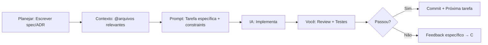

# Guia de Vibe Coding com IA

> **Local:** `03 - Guias Práticos/Guia de Vibe Coding.md`
> **Baseado em:** [[02 - Modelos/Desenvolvimento/Guia de Vibe Coding com IA]]
> **Objetivo:** Referência rápida de prompts, padrões e workflows para desenvolvimento assistido por IA (Claude Code).

---

## Princípios Fundamentais

| Princípio | Prática |
|-----------|---------|
| **IA como Co-piloto, não Autopiloto** | Você decide arquitetura, IA executa detalhes |
| **Contexto é Rei** | Forneça arquivos relevantes (`@arquivo`) antes de pedir código |
| **Pequenas Iterações** | Uma tarefa por prompt → teste → próximo |
| **Valide Sempre** | Rode testes, lint, build após cada mudança da IA |
| **Commit Frequente** | `git commit -m "feat: ..."` a cada incremento válido |

---

## Workflow Padrão (Claude Code)



### Sessão Típica (30-60 min)

1. **Setup (2 min):** `git status`, abrir arquivos base
2. **Prompt Inicial (1 min):** Contexto + objetivo claro
3. **Iteração (20-40 min):** Prompt → Review → Teste → Commit
4. **Wrap-up (5 min):** Lint, testes completos, push, documentar decisões

---

## Prompts Essenciais (Copie e Adapte)

### 1. Nova Feature Completa
```markdown
@arquivos-relevantes

**Objetivo:** Implementar [feature] conforme [[ADR-XXX]] / [[ETAPA XX]].

**Contexto:** 
- Stack: Next.js 15 + TypeScript + Prisma + Tailwind
- Padrão: Server Components + Server Actions
- Testes: Vitest (unit) + Playwright (e2e)

**Requisitos:**
1. [Requisito 1 - rastreável a RF-XX]
2. [Requisito 2]
3. [Edge case: ...]

**Constraints:**
- Não use `any` — tipagem estrita
- Siga [[Checklist de Código]]
- Cobertura alvo: unit ≥ 80%, branch ≥ 70%
- Acessibilidade: WCAG 2.1 AA

**Entregáveis:**
- Código em `src/...`
- Testes em `src/.../test/`
- Atualizar CHANGELOG se user-facing
```

### 2. Bug Fix Direcionado
```markdown
@src/app/pedidos/[id]/page.tsx @src/lib/pedidos.ts

**Bug:** [Descrição clara - ex: "Status não atualiza via SSE quando aba em background"]

**Reprodução:**
1. Abrir pedido
2. Mudar aba 30s
3. Voltar → status desatualizado

**Hipótese:** EventSource não reconecta com `last-event-id` correto

**Investigação pedida:**
- Verificar `EventSource` reconnection logic
- Verificar headers `Last-Event-ID` no request
- Logs Vercel: `SSE reconnect`

**Fix esperado:** Mínima mudança, teste de regressão
```

### 3. Refatoração Segura
```markdown
@src/lib/parsers/whatsapp.ts

**Objetivo:** Refatorar parser WhatsApp para suportar novos formatos de mensagem (imagem, localização, contato).

**Estado Atual:** Função única 200 linhas, difícil testar

**Target:** 
- Separar por tipo: `parseText`, `parseImage`, `parseLocation`, `parseContact`
- Interface comum `ParsedMessage`
- Testes unitários por tipo (≥ 10 casos cada)
- Manter compatibilidade: mesma assinatura pública

**Constraints:**
- Não quebrar webhook existente
- Performance: < 5ms por mensagem
- Cobertura: 100% branches
```

### 4. Adicionar Testes (Cobertura)
```markdown
@src/lib/validators/pedido.ts @src/lib/validators/pedido.test.ts

**Objetivo:** Aumentar cobertura de `validarPedido` para 100% branches.

**Gaps atuais:** (rodar `npm run test:coverage`)
- Linha 45: `if (itens.length === 0)` — branch false não testado
- Linha 62: `catch (e)` — erro de parsing JSON não coberto
- Linha 78: `default` no switch status — valor inválido

**Entregável:** Testes adicionais cobrindo gaps, sem alterar código fonte
```

### 5. Code Review (IA revisa seu código)
```markdown
@src/app/api/webhook/whatsapp/route.ts

**Code Review:** Verificar este arquivo contra:
- [[Checklist de Código]] (segurança, performance, estilo)
- [[Regras de Negócio]] (RN-001 a RN-037)
- OWASP Top 10 (especialmente: injection, broken auth, sensitive data)

**Formato resposta:**
```
## Issues Encontrados
### 🔴 Crítico
- [Linha X] Descrição + fix sugerido

### 🟡 Atenção
- [Linha X] Descrição + sugestão

### 🟢 Sugestão
- [Linha X] Melhoria opcional

## Resumo: Aprovar / Revisar / Rejeitar
```
```

---

## Padrões de Arquitetura (Para IA Seguir)

### Server Action Padrão
```typescript
// src/actions/pedidos.ts
"use server"

import { prisma } from "@/lib/prisma"
import { revalidatePath } from "next/cache"
import { z } from "zod"

const AtualizarStatusSchema = z.object({
  pedidoId: z.string().cuid(),
  status: z.enum(["NOVO", "PREPARANDO", "PRONTO", "ENTREGUE", "CANCELADO"]),
  usuarioId: z.string().cuid(), // do auth
})

export async function atualizarStatus(input: z.infer<typeof AtualizarStatusSchema>) {
  // 1. Validar input
  const { pedidoId, status, usuarioId } = AtualizarStatusSchema.parse(input)
  
  // 2. Verificar permissão (RLS via Prisma middleware ou check manual)
  const pedido = await prisma.pedido.findUnique({
    where: { id: pedidoId },
    select: { lojaId: true, status: true }
  })
  if (!pedido) throw new Error("Pedido não encontrado")
  if (pedido.lojaId !== usuarioId) throw new Error("Não autorizado")
  
  // 3. Regra de negócio: transição válida?
  if (!TRANSICOES_VALIDAS[pedido.status]?.includes(status)) {
    throw new Error(`Transição inválida: ${pedido.status} → ${status}`)
  }
  
  // 4. Executar
  const atualizado = await prisma.pedido.update({
    where: { id: pedidoId },
    data: { status, updatedAt: new Date() }
  })
  
  // 5. Revalidar cache + notificar SSE
  revalidatePath(`/dashboard`)
  await notificarSSE(pedido.lojaId, { type: "STATUS_CHANGED", pedido: atualizado })
  
  return { success: true, pedido: atualizado }
}
```

### Componente React Padrão (Server + Client)
```tsx
// src/components/pedidos/PedidoCard.tsx (Server Component)
import { Pedido } from "@prisma/client"
import { StatusBadge } from "./StatusBadge"
import { formatarMoeda } from "@/lib/utils"

interface Props {
  pedido: Pedido & { itens: ItemPedido[] }
  onAtualizar: (id: string, status: Status) => Promise<void>
}

export function PedidoCard({ pedido, onAtualizar }: Props) {
  return (
    <article className="card p-4 space-y-3">
      <header className="flex justify-between items-start">
        <h3 className="font-medium">Pedido #{pedido.numero}</h3>
        <StatusBadge status={pedido.status} />
      </header>
      <dl className="grid grid-cols-2 gap-2 text-sm text-muted">
        <div><dt>Cliente</dt><dd>{pedido.clienteNome}</dd></div>
        <div><dt>Total</dt><dd>{formatarMoeda(pedido.total)}</dd></div>
        <div><dt>Itens</dt><dd>{pedido.itens.length}</dd></div>
        <div><dt>Hora</dt><dd>{formatarHora(pedido.createdAt)}</dd></div>
      </dl>
      <div className="flex gap-2">
        {TRANSICOES_VALIDAS[pedido.status]?.map((s) => (
          <button
            key={s}
            className="btn btn-sm btn-outline flex-1"
            onClick={() => onAtualizar(pedido.id, s)}
          >
            {s}
          </button>
        ))}
      </div>
    </article>
  )
}
```

### Hook SSE Padrão
```typescript
// src/hooks/useSSE.ts
"use client"
import { useEffect, useRef, useState, useCallback } from "react"

interface SSEMessage {
  type: "NEW_ORDER" | "STATUS_CHANGED" | "HEARTBEAT"
  payload: unknown
}

export function useSSE(lojaId: string) {
  const [status, setStatus] = useState<"connecting" | "open" | "closed">("connecting")
  const [lastEventId, setLastEventId] = useState<string>("")
  const eventSourceRef = useRef<EventSource | null>(null)
  const reconnectTimeoutRef = useRef<NodeJS.Timeout>()

  const connect = useCallback(() => {
    if (eventSourceRef.current) return
    
    const url = `/api/sse?lojaId=${lojaId}&lastEventId=${lastEventId}`
    const es = new EventSource(url)
    eventSourceRef.current = es

    es.onopen = () => setStatus("open")
    es.onerror = () => {
      setStatus("closed")
      es.close()
      eventSourceRef.current = null
      reconnectTimeoutRef.current = setTimeout(connect, 3000) // backoff
    }

    es.addEventListener("message", (e) => {
      const msg: SSEMessage = JSON.parse(e.data)
      setLastEventId(e.lastEventId)
      // Disparar callback ou estado global (Zustand/Context)
      window.dispatchEvent(new CustomEvent("sse-message", { detail: msg }))
    })
  }, [lojaId, lastEventId])

  useEffect(() => {
    connect()
    return () => {
      eventSourceRef.current?.close()
      clearTimeout(reconnectTimeoutRef.current)
    }
  }, [connect])

  return { status, lastEventId }
}
```

---

## Checklist de Qualidade Pré-Commit (IA + Você)

```bash
# Rode SEMPRE antes de commit
npm run lint        # 0 errors
npm run typecheck   # 0 errors  
npm run test        # 100% pass
npm run build       # Success
```

### Validações que a IA DEVE fazer sozinha
- [ ] Tipagem TypeScript estrita (sem `any`, `unknown` bem tratado)
- [ ] Tratamento de erro em async/await (try/catch + return Result)
- [ ] Validação de input (Zod) em TODAS Server Actions / API routes
- [ ] Sem secrets no código (vars de ambiente apenas)
- [ ] Logs estruturados (JSON) para produção
- [ ] Acessibilidade: labels, roles, aria-*, foco visível
- [ ] Performance: sem N+1 queries, bundle size OK

---

## Armadilhas Comuns (E Como Evitar)

| Armadilha | Sinal | Prevenção |
|-----------|-------|-----------|
| **IA alucina API inexistente** | "Import not found" | `@package.json` no contexto, peça para verificar |
| **IA ignora regra de negócio** | Bug em produção | Sempre referencie `[[Regras de Negócio]]` no prompt |
| **IA quebra testes existentes** | CI falha | Rode testes após CADA mudança da IA |
| **IA usa padrão errado** | Código inconsistente | Dê exemplos concretos no prompt (`@arquivo-exemplo`) |
| **IA over-engineering** | Código complexo demais | Diga: "Mínimo necessário, YAGNI" |
| **Contexto perdido** | IA repete erros | Resuma decisões no `scratchpad.md` ou `CLAUDE.md` do projeto |

---

## Dicas de Produtividade

### Atalhos Claude Code Úteis
| Atalho | Ação |
|--------|------|
| `Ctrl+R` | Re-executar último comando |
| `Ctrl+B` | Background agent (longa duração) |
| `@arquivo` | Injetar arquivo no contexto |
| `#símbolo` | Referenciar símbolo (função, tipo) |
| `/compact` | Resumir contexto longo |
| `/clear` | Nova sessão limpa |

### Organização de Contexto
```
Projeto/
├── CLAUDE.md          # Instruções persistentes do projeto
├── scratchpad.md      # Notas temporárias, decisões, TODOs
├── .claude/
│   └── settings.json  # Permissões, hooks locais
```

### Template `CLAUDE.md` do Projeto
```markdown
# Projeto: [Nome]

## Stack
- Next.js 15 (App Router) + TypeScript + Tailwind
- Prisma + Neon (PostgreSQL)
- NextAuth v5 (Magic Link + Credentials)
- Vitest + Playwright + axe

## Padrões Obrigatórios
- Server Components por default
- Server Actions para mutações
- Zod para validação
- Result<T, E> para erros (nunca throw em actions)
- Testes: unit (Vitest) + e2e (Playwright)

## Arquivos-Chave para Contexto
@src/lib/prisma.ts @src/lib/auth.ts @src/actions/pedidos.ts
@src/components/pedidos/ @src/app/api/webhook/

## Regras de Negócio Críticas
Ver [[Regras de Negócio]] — RN-001 a RN-037

## Comandos Úteis
`npm run dev` | `npm run test` | `npm run lint` | `npm run typecheck`
`npx prisma studio` | `vercel logs` | `vercel rollback`
```

---

## Exemplo de Sessão Completa (Log Real)

> **Cenário:** Adicionar filtro de data no dashboard

```bash
# 1. Iniciar sessão
claude

# 2. Contexto
> @src/app/dashboard/page.tsx @src/components/pedidos/PedidoList.tsx

# 3. Prompt
> Adicionar filtro de data (hoje/semana/mês/custom) no dashboard.
> Server Component + URL searchParams. Manter SSR.
> Testes: unit (filtro) + e2e (interação).

# 4. IA implementa → Você review → Testes passam
> npm run test  # ✓
> npm run build # ✓

# 5. Commit
> git add -A && git commit -m "feat(dashboard): adicionar filtro de data por período"

# 6. Push + Deploy Preview
> git push origin feat/data-filter
> # Vercel cria preview automático
```

---

## Troubleshooting Rápido

| Problema | Solução |
|----------|---------|
| IA repete erro | `/clear` + recomece com `@CLAUDE.md` + `@arquivo-problema` |
| Contexto muito grande | `/compact` ou divida em sub-tarefas |
| IA não segue estilo | Adicione `@.eslintrc.json @tailwind.config.ts` no prompt |
| Testes flaky | Peça `test.retry(2)` temporário + issue para fixar root cause |
| Build falha no Vercel mas passa local | `vercel build --local` para debugar |

---

## Próximos Passos
- [[03 - Guias Práticos/Guia de UI/UX]] — Design System, componentes, acessibilidade
- [[03 - Guias Práticos/Guia de Testes]] — Estratégia, ferramentas, casos
- [[03 - Guias Práticos/Guia de Segurança]] — Checklist, LGPD, OWASP
- [[03 - Guias Práticos/Guia de Publicação]] — Deploy, monitoramento, runbook
- [[02 - Modelos/Desenvolvimento/Guia de Vibe Coding com IA]] — Modelo completo (já criado)

---

## Referências Rápidas
- [[04 - Referência/Glossário/Vibe Coding]]
- [[04 - Referência/Glossário/Server Components]]
- [[04 - Referência/Glossário/Server Actions]]
- [[04 - Referência/Glossário/SSE]]
- [[04 - Referência/Ferramentas/Claude Code]]
- [[04 - Referência/Ferramentas/Vitest]]
- [[04 - Referência/Ferramentas/Playwright]]