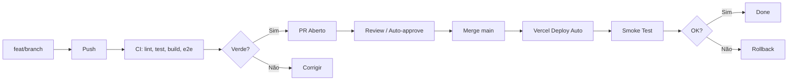

# Conceitos Fundamentais

> **Local:** `04 - Referência/Conceitos.md`
> **Objetivo:** Explicações conceituais dos pilares do Software Engineering OS — para consulta quando precisar entender o "porquê" por trás das práticas.

---

## Vibe Coding (Desenvolvimento Assistido por IA)

### O que é
Metodologia onde o desenvolvedor humano atua como **arquiteto/decisor** e a IA (Claude Code) atua como **executor/implementador**. Não é "deixar a IA codar sozinha" — é **colaboração intencional**.

### Princípios
| Princípio | Prática |
|-----------|---------|
| **Contexto > Prompt** | Forneça arquivos (`@arquivo`), não apenas instruções textuais |
| **Pequenas iterações** | Uma tarefa por prompt → valide → commit → próxima |
| **Validação obrigatória** | `npm run test && npm run lint && npm run build` após CADA mudança |
| **Decisões humanas** | Arquitetura, priorização, trade-offs = você. Sintaxe, boilerplate, testes = IA |
| **Memória externa** | `CLAUDE.md` do projeto + `scratchpad.md` para decisões contextuais |

### Ciclo Padrão
```
1. PLANEJAR    → Escrever spec/ADR/issue claro
2. CONTEXTO    → @arquivos-relevantes + referências
3. PROMPT      → Tarefa específica + constraints + exemplos
4. EXECUTAR    → IA implementa
5. REVISAR     → Você lê, entende, questiona
6. TESTAR      → Rodar suite completa
7. COMMIT      → Mensagem convencional + push
8. REPETIR     → Próxima tarefa
```

### Anti-patterns a Evitar
- ❌ Prompt vago: "Faça o dashboard"
- ❌ Aceitar código sem ler/entender
- ❌ Pular testes porque "a IA fez"
- ❌ Contexto insuficiente (IA alucina APIs)
- ❌ Não commitar incrementos válidos

---

## Server Components vs Client Components (Next.js 15)

### Server Components (Default)
```tsx
// RODA SÓ NO SERVER - Zero JS no client
async function PedidoList() {
  const pedidos = await getPedidos() // DB direto, sem API
  return <ul>{pedidos.map(p => <li key={p.id}>{p.clienteNome}</li>)}</ul>
}
```
**Vantagens:** SEO, performance, acesso direto a DB/segredos, bundle menor.

### Client Components (`"use client"`)
```tsx
"use client"
import { useState } from "react"
export function Contador() {
  const [count, setCount] = useState(0)
  return <button onClick={() => setCount(c => c + 1)}>{count}</button>
}
```
**Quando usar:** Interatividade (onClick, useState, useEffect), browser APIs, hooks customizados.

### Regra Prática
> **Comece com Server Component.** Adicione `"use client"` só quando precisar de interatividade. Mantenha a fronteira o mais baixa possível na árvore.

---

## Server Actions (Mutations Seguras)

### Conceito
Funções assíncronas que rodam no server, chamadas diretamente do client como se fossem locais. Substituem API Routes para mutações.

```tsx
// src/actions/pedidos.ts
"use server"
export async function atualizarStatus(pedidoId: string, status: Status) {
  const session = await auth()
  if (!session) throw new Error("Não autenticado")
  
  // Validação, autorização, DB, revalidate, notificar
  const pedido = await prisma.pedido.update({ where: { id: pedidoId }, data: { status } })
  revalidatePath("/dashboard")
  await notificarSSE(session.user.lojaId, { type: "STATUS_CHANGED", pedido })
  return { success: true, pedido }
}

// Uso no Client Component:
"use client"
export function BotaoStatus({ pedidoId, status }) {
  const action = useTransition() // ou useActionState
  return <button onClick={() => action(atualizarStatus, pedidoId, status)}>...</button>
}
```

### Benefícios
- **Type-safe** end-to-end (TypeScript compartilhado)
- **Progressive enhancement** — funciona sem JS (form nativo)
- **Segurança** — segredos no server, validação Zod obrigatória
- **Cache** — `revalidatePath` / `revalidateTag` integrado

---

## SSE (Server-Sent Events) vs WebSocket

### SSE (Escolha do MVP)
| Aspecto | SSE | WebSocket |
|---------|-----|-----------|
| **Protocolo** | HTTP/1.1+ (nativo) | ws:// (upgrade) |
| **Direção** | Server → Client | Bidirecional |
| **Reconexão** | Automática (EventSource) | Manual |
| **Firewall/Proxy** | Passa fácil | Pode bloquear |
| **Vercel Hobby** | ✅ 10s timeout | ❌ Não suportado |
| **Escala** | Limitado (~100 conn/função) | Requer Pusher/Ably |

### Implementação SSE (Next.js)
```typescript
// src/app/api/sse/route.ts
export async function GET(req: Request) {
  const { searchParams } = new URL(req.url)
  const lojaId = searchParams.get("lojaId")!
  const lastEventId = searchParams.get("lastEventId") || ""
  
  const stream = new ReadableStream({
    async start(controller) {
      const encoder = new TextEncoder()
      const send = (event: string, data: object, id?: string) => {
        controller.enqueue(encoder.encode(`event: ${event}\nid: ${id || Date.now()}\ndata: ${JSON.stringify(data)}\n\n`))
      }
      
      // Heartbeat
      const heartbeat = setInterval(() => send("heartbeat", {}), 30000)
      
      // Subscribe to Redis/PostgreSQL NOTIFY ou in-memory map
      const unsubscribe = subscribe(lojaId, (msg) => send("message", msg))
      
      req.signal.addEventListener("abort", () => {
        clearInterval(heartbeat)
        unsubscribe()
      })
    }
  })
  
  return new Response(stream, {
    headers: { "Content-Type": "text/event-stream", "Cache-Control": "no-cache", "Connection": "keep-alive" }
  })
}
```

### Client Hook
```typescript
// src/hooks/useSSE.ts
export function useSSE(lojaId: string) {
  const [status, setStatus] = useState<"connecting"|"open"|"closed">("connecting")
  const [lastEventId, setLastEventId] = useState("")
  
  useEffect(() => {
    const es = new EventSource(`/api/sse?lojaId=${lojaId}&lastEventId=${lastEventId}`)
    es.onopen = () => setStatus("open")
    es.onerror = () => { setStatus("closed"); es.close(); setTimeout(reconnect, 3000) }
    es.addEventListener("message", (e) => {
      setLastEventId(e.lastEventId)
      window.dispatchEvent(new CustomEvent("sse-message", { detail: JSON.parse(e.data) }))
    })
    return () => es.close()
  }, [lojaId, lastEventId])
  
  return { status, lastEventId }
}
```

---

## Row Level Security (RLS) - Isolamento Multi-Tenant

### Problema
Múltiplas lojas no mesmo banco. Uma loja NUNCA deve acessar dados de outra.

### Solução: PostgreSQL RLS + Prisma Middleware
```sql
-- Migration
ALTER TABLE "Pedido" ENABLE ROW LEVEL SECURITY;
CREATE POLICY "pedido_isolation" ON "Pedido"
  USING ("lojaId" = current_setting('app.current_loja_id')::uuid);
```

```typescript
// src/lib/prisma.ts
prisma.$use(async (params, next) => {
  if (["Pedido", "ItemPedido", "ConfiguracaoLoja"].includes(params.model || "")) {
    const session = await getServerSession()
    if (session?.user?.lojaId) {
      await prisma.$executeRaw`SET LOCAL app.current_loja_id = ${session.user.lojaId}`
    }
  }
  return next(params)
})
```

### Garantias
- **Mesmo se bug no código** → DB bloqueia acesso cross-tenant
- **Performance** — índice em `lojaId` + policy nativa
- **Auditoria** — Policy centralizada, não espalhada no código

---

## Idempotência em Webhooks

### Por que Crítico
WhatsApp reenvia webhooks em falhas de rede, timeouts, 5xx. Processar duplicado = pedido duplicado, cobrança dupla, notificação dupla.

### Padrão: Chave de Idempotência (`message_id`)
```typescript
// 1. Receber webhook
const messageId = payload.entry?.[0]?.changes?.[0]?.value?.messages?.[0]?.id

// 2. Verificar/Registrar ANTES de processar
const existing = await prisma.webhookEvent.findUnique({ where: { messageId } })
if (existing) {
  return Response.json({ success: true, duplicate: true }) // 200 OK, não processa
}

// 3. Registrar evento RECEBIDO
await prisma.webhookEvent.create({ data: { messageId, payload, status: "RECEBIDO" } })

// 4. Processar ASSÍNCRONO (não bloquear webhook)
processarWebhookAsync(payload).catch(err => {
  // Atualizar status para ERRO
  prisma.webhookEvent.update({ where: { messageId }, data: { status: "ERRO", error: err.message } })
})
```

### Tabela de Eventos
```prisma
model WebhookEvent {
  id        String   @id @default(cuid())
  messageId String   @unique
  payload   Json
  status    WebhookStatus @default(RECEBIDO)
  error     String?
  createdAt DateTime @default(now())
  processedAt DateTime?
  
  @@index([status])
  @@map("webhook_events")
}
enum WebhookStatus { RECEBIDO PROCESSANDO SUCESSO ERRO DUPLICADO }
```

---

## Feature Flags (Lançamento Gradual)

### v1: Simples (Env Vars + Tabela)
```typescript
// src/lib/flags.ts
export const flags = {
  ENABLE_SSE: process.env.ENABLE_SSE !== "false",
  ENABLE_PWA: process.env.ENABLE_PWA !== "false",
  ENABLE_TEMPLATES: process.env.ENABLE_TEMPLATES !== "false",
  MAX_PEDIDOS_PAGE: Number(process.env.MAX_PEDIDOS_PAGE) || 20,
} as const
```

### v1.1+: Vercel Edge Config
```bash
# Vercel Dashboard → Edge Config → Create
# Chave: flags, Valor: {"ENABLE_SSE": true, "NEW_UI": false}
```

```typescript
// src/lib/flags.ts (Edge Config)
import { createClient } from "@vercel/edge-config"
const edgeConfig = createClient(process.env.EDGE_CONFIG!)

export async function getFlags() {
  return edgeConfig.get("flags") || { ENABLE_SSE: true, ENABLE_PWA: true }
}
```

### Uso
```tsx
// Server Component
const flags = await getFlags()
if (flags.ENABLE_SSE) { return <SSEProvider>...</SSEProvider> }

// Client Component (via API ou context)
const { flags } = useFlags()
{flags.ENABLE_REPORTS && <RelatoriosButton />}
```

---

## Observabilidade (Logs, Métricas, Traces)

### Três Pilares
| Pilar | Ferramenta | O que Captura |
|-------|------------|---------------|
| **Logs** | Vercel Logs / Sentry | Eventos discretos, erros, requests |
| **Métricas** | Vercel Analytics / Custom | Latência, throughput, error rate, business KPIs |
| **Traces** | Vercel / OpenTelemetry | Fluxo requisição através de serviços |

### Logs Estruturados (JSON)
```typescript
// src/lib/logger.ts
export function log(level: "info"|"warn"|"error", event: string, data: Record<string, unknown>) {
  console.log(JSON.stringify({
    timestamp: new Date().toISOString(),
    level: level.toUpperCase(),
    event,
    requestId: headers().get("x-vercel-id") || crypto.randomUUID(),
    ...sanitize(data), // Remove secrets, hasheia PII
  }))
}

// Uso
log("info", "PEDIDO_CRIADO", { pedidoId, lojaId, total, itens: itens.length })
log("error", "WEBHOOK_FALHA", { messageId, error: err.message, stack: err.stack })
```

### Métricas Custom (Vercel)
```typescript
// src/lib/metrics.ts
export function metric(name: string, value: number, tags: Record<string, string> = {}) {
  // Envia para Vercel via header ou log estruturado
  console.log(JSON.stringify({
    timestamp: new Date().toISOString(),
    type: "METRIC",
    name,
    value,
    tags,
  }))
}

// Uso
metric("webhook_latency_ms", latency, { endpoint: "whatsapp", status: "200" })
metric("pedido_processado", 1, { status: "NOVO", canal: "WHATSAPP" })
```

---

## LGPD na Prática (Checklist Conceitual)

### Princípios (Art. 6 LGPD)
1. **Finalidade** — Coletar só para propósito claro e legítimo
2. **Adequação** — Dados compatíveis com finalidade informada
3. **Necessidade** — Mínimo necessário (minimização)
4. **Livre Acesso** — Titular consulta seus dados
5. **Qualidade** — Dados exatos, claros, atualizados
6. **Transparência** — Info clara sobre tratamento
7. **Segurança** — Medidas técnicas/administrativas
8. **Prevenção** — Prevenir vazamentos/uso indevido
9. **Não Discriminação** — Não usar para fins discriminatórios
10. **Responsabilização** — Demonstrar conformidade

### Base Legal por Dado
| Dado | Base Legal (Art. 7) | Retenção |
|------|---------------------|----------|
| Nome, telefone lojista | Execução contrato | Conta ativa + 30 dias |
| Email (auth) | Consentimento / Legítimo interesse | Conta ativa + 30 dias |
| Pedidos (cliente final) | Execução contrato | 6 meses pós-entrega |
| Hash senha | Segurança / Legítimo interesse | Conta ativa + 30 dias |
| Logs acesso | Legítimo interesse (segurança) | 90 dias |
| Analytics agregado | Legítimo interesse | 13 meses (GA4) |

### Direitos do Titular (Implementados)
- **Acesso** — `GET /api/lgpd?acao=exportar` → JSON com todos dados
- **Retificação** — Editar perfil na UI
- **Exclusão** — `POST /api/lgpd { acao: "excluir" }` → Anonimização + soft delete
- **Portabilidade** — Export JSON (mesmo endpoint de acesso)
- **Oposição** — Opt-out marketing (checkbox onboarding)
- **Revogação** — Deletar conta = revoga consentimento

---

## GitOps (Deploy = Merge)

### Princípio
**O estado desejado está no Git.** `main` = produção. Qualquer mudança: PR → CI → Merge → Deploy automático.

### Fluxo


### Vantagens
- **Auditoria** — Todo deploy rastreável no Git
- **Rollback** — `git revert` ou `vercel rollback` em segundos
- **Reprodutibilidade** — Mesmo commit = mesmo deploy
- **Colaboração** — PR = code review + preview URL

---

## Tech Debt (Dívida Técnica) - Gestão Consciente

### Definição
Decisão deliberada de priorizar velocidade sobre qualidade, com **plano de pagamento**. Não é "código ruim" — é **trade-off documentado**.

### Classificação
| Tipo | Exemplo | Pagamento |
|------|---------|-----------|
| **Arquitetural** | Monolito que deveria ser modular | Refatoração planejada |
| **Testes** | Cobertura < target em módulo crítico | Adicionar testes |
| **Performance** | Query N+1 temporária | Otimizar + índice |
| **Segurança** | Dependency com CVE conhecida | Upgrade + testar |
| **Documentação** | ADR faltando para decisão | Escrever ADR |

### Registro Obrigatório
```markdown
# Tech Debt Log
| ID | Descrição | Causa | Impacto | Esforço | Prioridade | Sprint Alvo | Status |
|----|-----------|-------|---------|---------|------------|-------------|--------|
| TD-001 | Parser WhatsApp simples | MVP speed | Falha em 5% msgs complexas | 3 dias | Should | v1.1 | 🔄 |
```

### Alocação
- **70%** Features / Bugs (Roadmap)
- **20%** Tech Debt / Refatoração / Testes
- **10%** Exploração / Spikes

---

## Change Management (Gestão de Mudanças)

### Tipos de Mudança
| Tipo | Definição | Aprovação | Deploy |
|------|-----------|-----------|--------|
| **Emergency** | Hotfix SEV-1 | Auto (você) | Imediato |
| **Standard** | Bug fix, feature minor, config | Você + CI verde | Agendado/Next window |
| **Major** | Breaking change, migração DB, nova arquitetura | Você + ADR review | Janela manutenção |

### Janela de Manutenção
- **Preferencial:** Terça/Quarta 10h-12h (baixo tráfego)
- **Emergency:** Qualquer hora
- **Comunicação:** Status page + email se downtime > 5 min

---

## Referências Cruzadas

| Conceito | Guia Prático | Modelo Detalhado |
|----------|--------------|------------------|
| Vibe Coding | [[03 - Guias Práticos/Guia de Vibe Coding]] | [[02 - Modelos/Desenvolvimento/Guia de Vibe Coding com IA]] |
| Server Components | [[03 - Guias Práticos/Guia de Vibe Coding]] | [[02 - Modelos/Requisitos e Arquitetura/Visão Técnica]] |
| Server Actions | [[03 - Guias Práticos/Guia de Vibe Coding]] | [[02 - Modelos/Requisitos e Arquitetura/Visão Técnica]] |
| SSE | [[03 - Guias Práticos/Guia de Publicação]] | [[02 - Modelos/Requisitos e Arquitetura/Visão Técnica]] |
| RLS | [[03 - Guias Práticos/Guia de Segurança]] | [[02 - Modelos/Requisitos e Arquitetura/Estratégia de Auth]] |
| Idempotência | [[03 - Guias Práticos/Guia de Segurança]] | [[02 - Modelos/Requisitos e Arquitetura/Registro de Integrações]] |
| Feature Flags | [[03 - Guias Práticos/Guia de Publicação]] | [[02 - Modelos/Publicação e Manutenção/Plano de Manutenção]] |
| Observabilidade | [[03 - Guias Práticos/Guia de Publicação]] | [[02 - Modelos/Publicação e Manutenção/Plano de Manutenção]] |
| LGPD | [[03 - Guias Práticos/Guia de Segurança]] | [[02 - Modelos/Segurança e Validação/Checklist de Segurança]] |
| GitOps | [[03 - Guias Práticos/Guia de Publicação]] | [[02 - Modelos/Publicação e Manutenção/Checklist de Deploy]] |
| Tech Debt | [[03 - Guias Práticos/Guia de Publicação]] | [[02 - Modelos/Publicação e Manutenção/Plano de Manutenção]] |
| Change Management | [[03 - Guias Práticos/Guia de Publicação]] | [[02 - Modelos/Publicação e Manutenção/Plano de Manutenção]] |