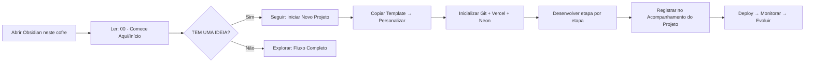

<p align="center">
  
</p>

<h1 align="center">Software Engineering OS</h1>

<p align="center">
  <strong>Seu manual pessoal de desenvolvimento de software com Vibe Coding no Obsidian.</strong>
</p>

<p align="center">
  <a href="#-o-que-é-este-cofre"><strong>O que é</strong></a> •
  <a href="#-como-começar"><strong>Como começar</strong></a> •
  <a href="#-estrutura-do-cofre"><strong>Estrutura</strong></a> •
  <a href="#-princípios-fundamentais"><strong>Princípios</strong></a> •
  <a href="#-etapas-do-manual"><strong>Etapas</strong></a> •
  <a href="#-navegação-rápida"><strong>Navegação</strong></a> •
  <a href="#-como-usar-no-dia-a-dia"><strong>Uso diário</strong></a>
</p>

<p align="center">
  
  
  
  
</p>

---

## 📖 O que é este cofre

Este é um **sistema completo de desenvolvimento de software** organizado como um manual prático e navegável. Ele cobre **todo o ciclo de vida de um software** — da ideia inicial à publicação, monitoramento, manutenção e evolução.

Foi desenhado para **estudantes de Engenharia de Software** e desenvolvedores que trabalham com **ferramentas de IA (especialmente Claude Code)** e utilizam o estilo **Vibe Coding** — onde a IA acelera a execução, mas você decide, aprova e assume a responsabilidade.

> **O diferencial:** Não é apenas teoria. Cada etapa tem critérios objetivos de "concluído", portões de aprovação (Executar → Verificar → Corrigir → Aprovar → Avançar) e modelos prontos para copiar e preencher.

---

## 🚀 Como começar

| Ação | Arquivo | Descrição |
|------|---------|-----------|
| 📖 **Entender o sistema** | [[00 - Comece Aqui/Início]] | Página inicial com visão geral completa |
| 🚀 **Iniciar um projeto novo** | [[00 - Comece Aqui/Iniciar Novo Projeto]] | Passo a passo visual para criar seu primeiro projeto |
| 🗺️ **Ver o fluxo completo** | [[00 - Comece Aqui/Fluxo Completo]] | Mapa mental de todas as 17 etapas |
| 📚 **Consultar modelos** | [[02 - Modelos/Índice de Modelos]] | 30+ modelos prontos para copiar e preencher |
| 🛠️ **Ver guias práticos** | [[03 - Guias Práticos/Índice de Guias]] | Guias especializados (Vibe Coding, Testes, UI/UX, Segurança, Publicação) |

---

## 📁 Estrutura do cofre

```
Software Engineering OS/
│
├── 00 - Comece Aqui/           # 🎯 Entrada principal e navegação rápida
├── 01 - Manual de Desenvolvimento/  # 📋 17 etapas numeradas do processo completo
├── 02 - Modelos/               # 📄 Modelos prontos para copiar e preencher
├── 03 - Guias Práticos/        # 🛠️ Guias especializados por tema
├── 04 - Referência/            # 📖 Glossário, ferramentas, conceitos fundamentais
└── 05 - Projetos/              # 💼 Seus projetos reais desenvolvidos com o manual
```

> **Nota:** A pasta `05 - Projetos/` é onde **você** cria seus projetos. O template base está em `05 - Projetos/Template/` (copie e renomeie).

---

## 🧭 Princípios fundamentais

| # | Princípio | O que significa na prática |
|---|-----------|----------------------------|
| 1 | **Processo sequencial** | Etapas numeradas com dependências claras — não pule etapas |
| 2 | **Critérios objetivos** | Cada etapa tem definição de "concluído" verificável (checklist) |
| 3 | **Portões de aprovação** | Ciclo: **Executar → Verificar → Corrigir → Aprovar → Avançar** |
| 4 | **Tratamento de bloqueios** | Procedimentos claros quando algo dá errado (não travar) |
| 5 | **Documentação proporcional** | Obrigatório / Condicional / Opcional — sem burocracia excessiva |
| 6 | **Linguagem acessível** | Português brasileiro, direto, sem jargão desnecessário |
| 7 | **Compatível com Vibe Coding** | IA acelera (pesquisa, código, testes, docs), você decide e aprova |

---

## 👥 Papéis no processo

| Papel | Responsabilidade | Exemplo |
|-------|------------------|---------|
| **USUÁRIO** (Você) | Decisões de negócio, aprovações, escolhas estratégicas | "Qual problema resolver?", "Aprovar escopo", "Escolher stack" |
| **IA** (Claude Code) | Pesquisa, redação, código, testes, análise, documentação | "Escrever ADR", "Criar testes", "Gerar componente" |
| **VALIDAÇÃO** | Verificações, testes, conferência de evidências | "Rodar lint", "Testar E2E", "Validar segurança" |

---

## 📋 Etapas do manual (visão geral)

| Etapa | Nome | Foco Principal | Entregável-chave |
|-------|------|----------------|------------------|
| **00** | Iniciar um novo projeto | Setup e estrutura inicial | Repositório git + pastas do projeto |
| **01** | Entender o problema e a oportunidade | Descoberta | Definição do Problema |
| **02** | Pesquisar e validar a ideia | Validação | Pesquisa e Validação + Decisão de Continuidade |
| **03** | Definir o produto e seu escopo | Produto | Definição do Produto + Escopo e Limites |
| **04** | Organizar os requisitos | Requisitos | Requisitos Funcionais + Qualidade + Critérios de Aceitação |
| **05** | Planejar a arquitetura e a solução técnica | Arquitetura | ADRs + Visão Técnica + Modelo de Dados |
| **06** | Planejar a experiência do usuário (UX) | UX | Jornada do Usuário + Wireframes |
| **07** | Pesquisar referências e definir direção visual | UI - Referências | Design System - Tokens |
| **08** | Estruturar a interface (UI) | UI - Estrutura | Especificação de Componentes + Acessibilidade |
| **09** | Preparar o ambiente e o plano de implementação | Preparação | Plano de Implementação + Guia Vibe Coding |
| **10** | Desenvolver o software por partes | Implementação | Código fonte + Checklist de Código |
| **11** | Executar testes e garantir a qualidade | Testes | Estratégia + Plano + Casos de Teste |
| **12** | Revisar segurança, privacidade e confiabilidade | Segurança | Checklist de Segurança |
| **13** | Validar o produto completo | Validação final | Plano de Validação |
| **14** | Publicar o software | Deploy | Checklist de Deploy |
| **15** | Monitorar e manter | Operação | Runbook + Plano de Manutenção |
| **16** | Encerrar ou transferir o projeto | Encerramento | Plano de Encerramento + Lições Aprendidas |

---

## 🔗 Navegação rápida

| Seção | Link | Para que serve |
|-------|------|----------------|
| **Início** | [[00 - Comece Aqui/Início]] | Página inicial do manual |
| **Visão Geral** | [[01 - Manual de Desenvolvimento/Visão Geral das Etapas]] | Todas as 17 etapas em detalhes |
| **Modelos** | [[02 - Modelos/Índice de Modelos]] | 30+ modelos prontos para usar |
| **Guias** | [[03 - Guias Práticos/Índice de Guias]] | Guias especializados por tema |
| **Glossário** | [[04 - Referência/Glossário]] | Termos técnicos explicados |
| **Projetos** | [[05 - Projetos/README]] | Seus projetos e template base |

---

## 🛠️ Como usar no dia a dia



**Resumo prático:**

1. **Abra o Obsidian** neste cofre (`Software Engineering OS`)
2. **Comece pela nota `Início`** em `00 - Comece Aqui`
3. **Quando tiver uma ideia**, vá para `Iniciar Novo Projeto`
4. **Use o `Fluxo Completo`** para ver o caminho todo de uma vez
5. **Em cada etapa**, consulte os **modelos** e **guias** indicados
6. **Registre seu progresso** no **Acompanhamento do Projeto** (modelo em `02 - Modelos/Projeto/`)

---

## ✅ Requisitos

| Requisito | Detalhes |
|-----------|----------|
| **Obsidian** | Versão recente (v1.5+) |
| **Plugins** | **Nenhum obrigatório** — funciona 100% com recursos nativos |
| **Formato** | Arquivos Markdown padrão (`.md`) |
| **IA recomendada** | [Claude Code](https://claude.ai/code) para Vibe Coding |

---

## 📄 Licença e uso

> **Este é seu manual pessoal.** Adapte, estenda, modifique conforme sua necessidade. O objetivo é que **você** consiga usá-lo para desenvolver software de forma organizada, consciente e profissional.

- ✅ Uso pessoal e comercial
- ✅ Modificação e distribuição
- ✅ Adaptação para seu fluxo de trabalho
- ⚠️ **Não** suba seus projetos pessoais para este repositório (estão no `.gitignore`)

---

## 🤝 Contribuições

Este é um projeto **pessoal/educacional**, mas sugestões são bem-vindas via Issues ou PRs:

1. Fork o repositório
2. Crie uma branch: `git checkout -b feat/minha-melhoria`
3. Commit: `git commit -m "feat: descrição da melhoria"`
4. Push: `git push origin feat/minha-melhoria`
5. Abra um Pull Request

---

## 📌 Status do projeto

| Item | Status |
|------|--------|
| Manual completo (17 etapas) | ✅ Concluído |
| Modelos (30+) | ✅ Concluído |
| Guias práticos (5) | ✅ Concluído |
| Referência (Glossário, Ferramentas, Conceitos) | ✅ Concluído |
| Template de projeto | ✅ Concluído |
| Exemplo real (PedidosSimples) | ✅ Concluído |

---

<div align="center">
  <sub>Última atualização: 2026-10-14 • Feito com ❤️ para desenvolvedores que querem profissionalizar seu processo</sub>
</div>